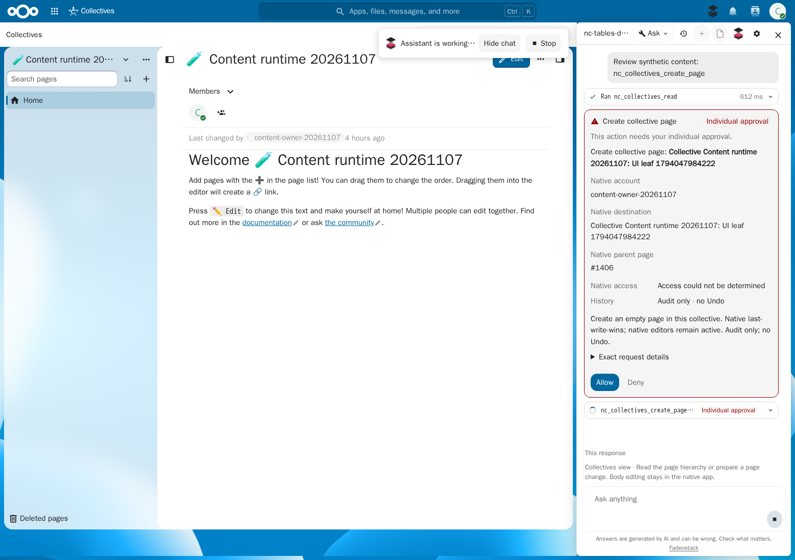
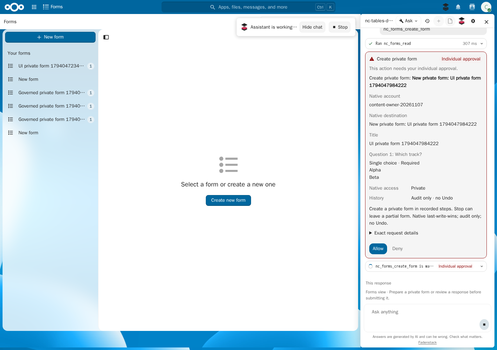
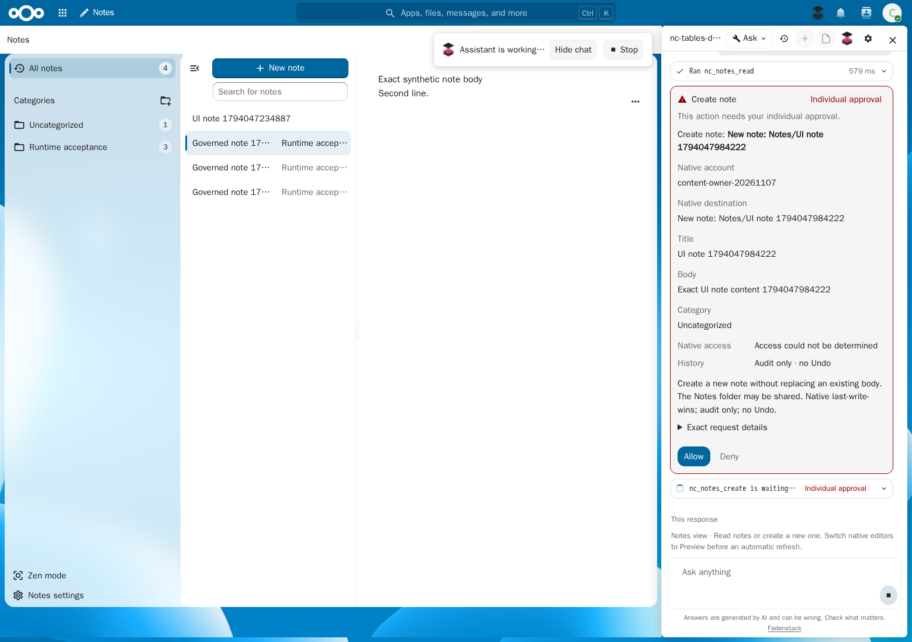
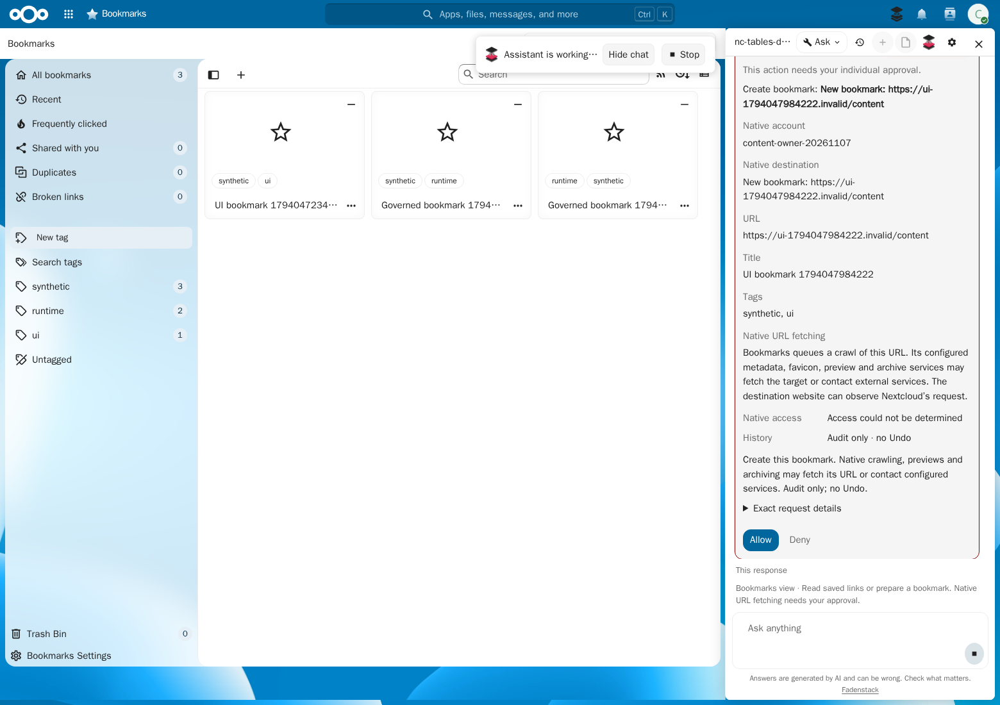

# Collectives, Forms, Notes and Bookmarks

Open the native app, then **Fadenstack Agent** in the Nextcloud header. Work on
the left and chat on the right. Sign in to Fadenstack separately when needed;
enterprise SSO is optional. Your current Nextcloud session controls native
access. Nextcloud passwords are not sent to Fadenstack.

These experimental providers are **disabled by default**. An administrator must
enable each provider, configure its collections and permit its tools. The
published agent must also permit them. The tested versions are Collectives
4.7.1, Forms 5.4.1, Notes 6.1.0 and Bookmarks 17.0.0 on Nextcloud 35.0.2.

| App | Tool | What it does | Governance |
|---|---|---|---|
| Collectives | `nc_collectives_read` | Read a configured collective's page hierarchy and permissions | Read |
| Collectives | `nc_collectives_create_page` | Create one empty page under an authorized parent | Individual approval; audit only |
| Collectives | `nc_collectives_delete_page` | Move one authorized leaf page to native trash | Individual approval; no Undo |
| Forms | `nc_forms_read` | Read owned summaries or an authorized form's definition and permissions | Read |
| Forms | `nc_forms_create_form` | Build a private form with text, single-choice or checkbox questions | Individual approval; audit only |
| Forms | `nc_forms_submit_response` | Submit the reviewed answers once as the current native user | Individual approval; irreversible |
| Notes | `nc_notes_read` | Read your authorized Notes collection, optionally by category | Read |
| Notes | `nc_notes_create` | Create a new note with the reviewed title, body and category | Individual approval; audit only |
| Bookmarks | `nc_bookmarks_read` | Search your saved bookmarks and tags without visiting their URLs | Read |
| Bookmarks | `nc_bookmarks_create` | Create a bookmark with the reviewed URL, title and tags | Individual approval; native crawling disclosed |

## Review each change

Ask for a read first. For example: “Read collective 12's hierarchy, then prepare
an empty child page called Project notes under page 34.” Review the native
account, destination and parent before choosing **Allow**. Only the real card's
Allow button authorizes a change; typed chat approval does not. **Deny** makes
no change. Collectives bodies, home pages and page subtrees stay in the native
editor.

For Forms, review every question, whether it is required and its option labels.
New forms remain private. To submit, ask the assistant to read the final form
and prepare your answers. The card shows question and answer meanings alongside
their native identifiers. Submission can trigger native notifications.

The tested Forms API accepts a submission without returning a submission ID.
The receipt therefore says **native accepted, stored answers unverified**.
Inspect Forms for the result; do not submit again automatically. If construction
is interrupted, an identifiable private partial form remains for inspection.

For Notes, state the exact new title, body and category. Existing note bodies
are never replaced. Finish native edits and select the native **Preview** mode
before an automatic refresh. The assistant does not change your editor mode.
The Notes folder can be shared, so the card does not promise a private audience.

For Bookmarks, check the final URL, title and tags. Native Bookmarks queues URL
crawling and may contact configured preview/archive services; the destination
can observe those requests. Reading bookmarks does not visit their URLs.
Credentials in URLs, IP/local hosts and ambiguous URL forms are refused. An
existing bookmark with the same URL requires native handling.

## Stop, native edits and history

The working overlay and chat share **Stop**. It prevents further agent dispatch;
an already-running native request can still finish. A timeout or lost response
does not authorize another create or submission. Use **Agent actions → Inspect
outcome** to see recorded attempts and known identifiers without repeating work.

These actions have an encrypted audit trail with **no certified Undo or Redo**.
Nextcloud's native Trash or Versions may help with supported objects, but do
not reverse submissions, notifications or external URL fetching. Another native
editor can still race after the final check: the card discloses native
last-write-wins behavior. Already observed changes invalidate the preview.

Dirty or unknown editors require a handoff. Finish or cancel native edits, then
explicitly reload or reopen a clean view. The assistant preserves native edits
and unsent chat drafts. Native child refresh does not reload the chat. On narrow
screens, hide chat while editing. Start a new chat when earlier source revisions
can no longer be safely reauthorized.

## Administrator rollback

Disable new writes with `provider_writes_enabled=0`, or disable a provider's
section while retaining its configured collections. Keep the installed audit
reader, journal keys and expiry workers so existing attempts remain inspectable.
Do not restore an older writer over new safety state or replay partial recipes.
Full-text Notes/Bookmarks pagination, arbitrary Forms question types and
collaborative-body replacement are outside this bounded release. Numeric Forms
must appear in the current user's native owned/shared list; hidden or unlisted
public forms require the native app. Native throttling withholds that provider's
tools; it never authorizes a retry or disables an unrelated healthy provider.
