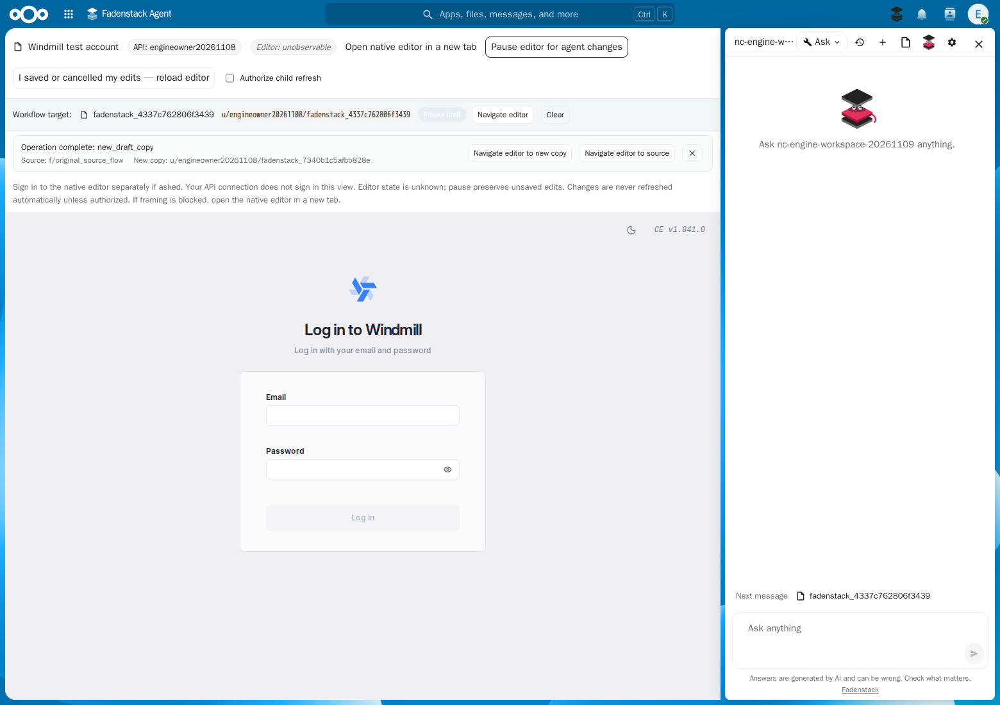
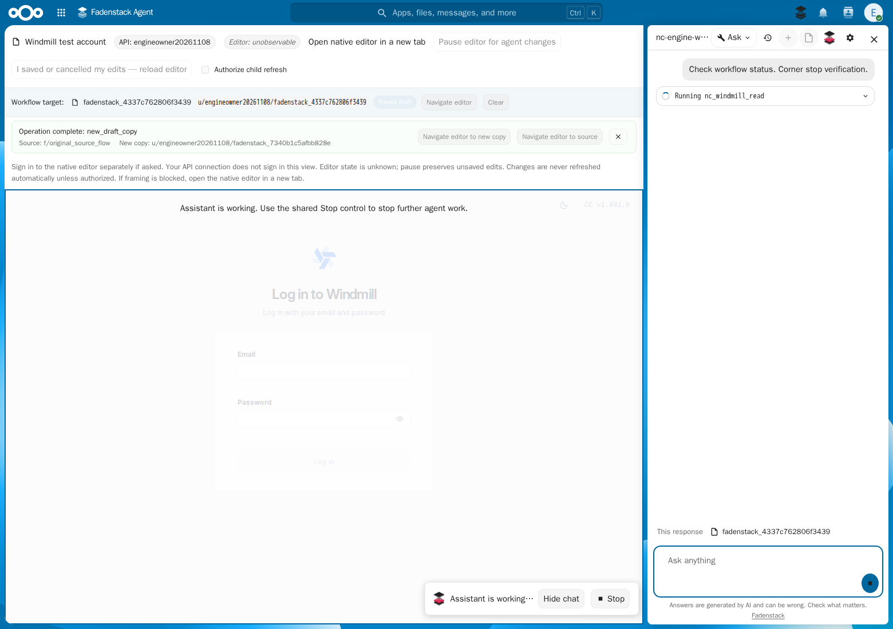
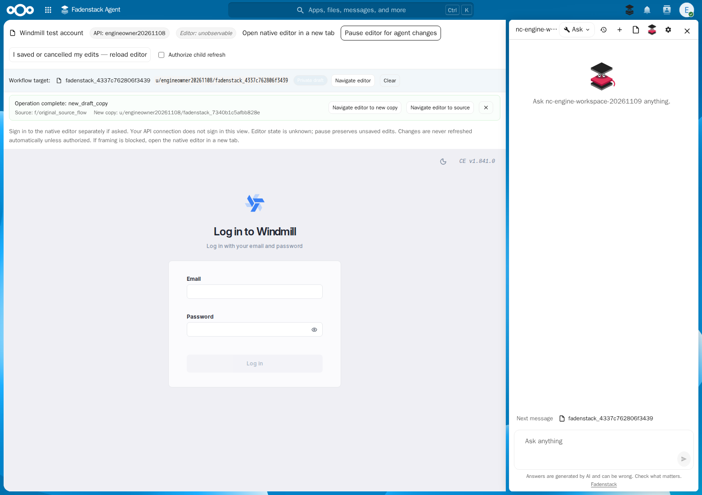
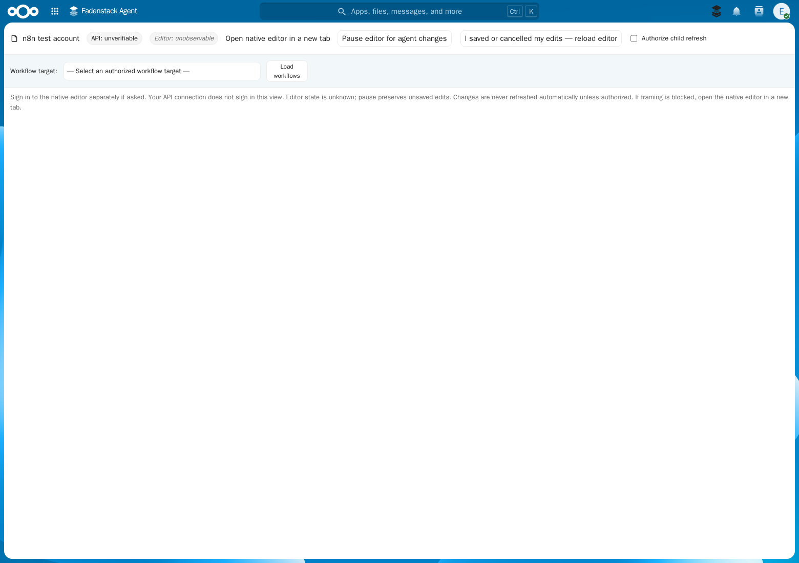

# Native workflow workspace

This experimental page keeps the native engine on the left and Fadenstack chat
on the right. It uses the ordinary engine UI, without changing either the
engine or the official Nextcloud integration apps. It provides a conservative
copilot workspace for an editor whose unsaved state Nextcloud cannot inspect.

1. Open **Settings → Workflow connections** in chat. Connect your own API
   account, then choose **Open native workflow workspace with chat**. The link
   opens a new Nextcloud tab; the original conversation stays on its page.
2. Sign in to Fadenstack in the new page and to the native editor separately
   if needed. An API connection does not log you into the editor; SSO is not
   required for the API tools. The API execution account (e.g. `admin@windmill.local`)
   is displayed in the toolbar badge.
3. Select an explicit workflow target:
   - For Windmill: Choose an authorized workflow or enter a private user draft path (e.g. `u/admin/draft_flow`).
   - For n8n: Choose an authorized workflow by reference.
   - The selected target is bound to the connection, canonical reference, source kind,
     and current native authorization. Changing the target invalidates stale approvals.
4. Before requesting an engine change, choose **Pause editor for agent
   changes**. This retains the same child and its unsaved content. It does not
   declare that content saved. Normal individual approval is still required.
5. Control editor refresh and navigation safely:
   - Windmill supports child-only iframe navigation to authorized targets and drafts.
   - If **Allow child refresh after agent mutations** is enabled, a successful mutation
     will automatically navigate the native child to the resulting draft or source.
     This authorization is strictly single-generation and is cleared on resume or manual child navigation.
   - Stock n8n blocks cross-origin framing (`SAMEORIGIN`); its targets and results provide
     an explicit **Open in new tab** fallback.
   - Only choose **I saved or cancelled my edits — reload editor** after saving or discarding
     edits in the native editor. This replaces only the child and preserves chat, sign-in,
     and an unfinished composer message.



While the assistant works, the native child is inert and the shared activity
overlay exposes the same **Stop** command as chat. Desktop Stop sits in the
native pane's bottom corner. Stop prevents further agent dispatch; it cannot
undo a native job or cancel one already accepted by the engine.



## Explicit workflow context and draft protection

The page explicitly distinguishes between:
- The target selected for agent operations.
- The workflow actually known to be open in the native editor.
- An editor whose current selection cannot be observed across origins.

A launch URL or configured connection alone does not prove the editor's current selection.
Never assume an open editor matches the agent's target.

When the agent executes a content mutation:
- The committed receipt distinguishes between modifying the **original source** versus creating a **new copy/draft**.
- The result banner provides child navigation (for Windmill) or separate-tab links (for n8n).
- If optional child navigation fails, the committed receipt is preserved and the operation is never repeated.



## Framing and authentication

Native security headers stay intact. The pinned n8n **2.43.8** server sends
`X-Frame-Options: SAMEORIGIN`, so its different-origin frame is blocked in this
fixture. Use **Open native editor in a new tab**. This checkpoint does not
certify an authenticated n8n editor inside Nextcloud, weaken that header or
provide an OEM/embedding licence. Windmill's first-party login page is also
tested; authenticated embedded editing remains a separate acceptance gate.



Deployments must test native sign-in and cookie behavior with their actual
HTTPS domains. Use distinct browser hostnames and host-only cookies; a broad
parent-domain cookie can still reach sibling hosts. Different ports do not
isolate cookies ([RFC 6265](https://datatracker.ietf.org/doc/html/rfc6265#section-8.5)).
The app refuses the Nextcloud hostname, including another port, and refuses a
browser hostname shared by different engine providers. Shared-origin embedding
requires separate deployment/security review and is outside this checkpoint.

## Administrator configuration

Default off. Configure existing typed `engine_connections`, native scope and
provider policy first. Add the optional app setting `engine_workspaces`:

```json
{
  "version": 1,
  "workspaces": [
    {"connectionId": "windmill-prod", "browserUrl": "https://windmill.example.net/user/login"},
    {"connectionId": "n8n-prod", "browserUrl": "https://n8n.example.net"}
  ]
}
```

IDs must match configured connections; at most eight entries are supported.
Only explicit HTTPS browser origins and simple native entry paths are allowed;
no URL credentials, query strings or fragments. Development mode additionally
permits localhost and IPv4 loopback HTTP origins. IPv6-literal browser entries
are refused because the tested Chromium rejects them as frame-CSP sources.
This restriction does not change native API endpoint support. The Windmill launch adds
the configured native workspace selector. Native API endpoints and encrypted
credentials stay separate and are not rotated by this UI setting.

The page requires the caller's current encrypted connection, a successful native
read probe and native provider scope. Its frame origin is allowed only on that
page's CSP. There is no URL proxy, global frame wildcard, native password store,
credential in a frame URL or injected engine script. A missing/invalid workspace
fails closed for engine changes.

Production authenticated framing, authoritative dirty/selection events,
automatic refresh, OAuth, live `.22` and package/pilot acceptance remain gated.
The [engine guide](workflow-engines.md) describes the six bounded tools and
their actual receipts, conflict and provenance limits.
