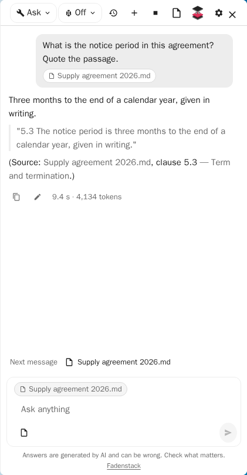
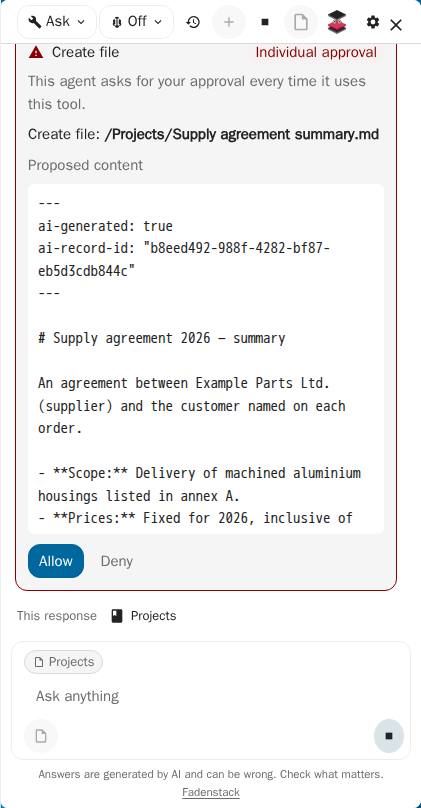
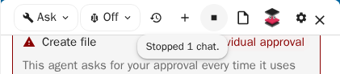

# Ask and approve

Include a file or folder, ask in your own words, and check each change before the agent makes it. No file is created or
changed until you select **Allow**, and you can stop the agent at any time.

## Include a file or folder

The agent reads only what you give it, and what its tools find in your files when you ask.

1. In Files, select a file or a folder (tick its box), or open its **Actions** menu and select **Ask Fadenstack**.
2. The file shows as a chip above the message box, with **Next message** next to it.

It is read only when you send your message. To leave it out, select the chip: it then says **Not included**. While
an answer is being written, the row says **This response**: choosing another file then prepares your next message
and does not change the answer in progress.

??? info "More about including files"
    - One file or one folder per message.
    - The agent reads the saved file, not what is open and unsaved in an editor. Save your edits first.
    - A search result card has **Open in Nextcloud** to look at the file and **Add to context** to include it.
    - What goes to your organisation's server when you include a file: see [Your data](your-data.md).

## Ask

Type your question and select **Send**. For example:

- "Find the latest supplier contract."
- "Find all PDFs in the folder Engineering."
- "What is the notice period in this contract?"
- "Write a summary of this document as a Markdown file in the same folder."

The agent finds and reads files on its own: those tools only read and need no approval. An answer that rests on a
document shows the passage, with the page or line, and a link to it. Check the passages for what matters.

## Approve a change

When the agent wants to create or change a file, it shows an approval card first.

1. Read the card: **Create file** or **Replace file**, where it goes, and the whole text under **Proposed content**.
   For a replacement, **Current content** shows what is there now.
2. Select **Allow** to save exactly this text, or **Deny** to save nothing.

After **Allow**, the chat says **Saved:** and the file's name, with a line about its AI mark (see
[AI marks](ai-marks.md)).

??? info "More about approvals"
    - Every change asks, one at a time. There is no "allow for this chat" or "allow always" for changes in this agent.
    - A new file goes into the folder you included, or into the folder of the file you included. Creating never
      overwrites a file that exists. Replacing works only if the file has not changed since the
      agent read it.
    - A card that waits too long expires; nothing is saved. Ask again for a new card.
    - If a file is open in an editor with unsaved changes, Nextcloud keeps your editor as it is: save or cancel your
      edits, then refresh the view.

## The tool mode

The tool mode in the panel's header sets what the agent may do without asking. Your organisation decides which
modes you can choose.

| Mode | What the agent does |
|---|---|
| **Off** | No tools: the agent only answers |
| **Read only** | Only tools that change nothing |
| **Ask** | Approve file actions one at a time (the usual mode) |
| **Auto** | Runs reading tools; file actions still need your individual approval |

In this agent every change of a file asks for your approval, whatever the mode. More in
[Tools in the chat](../../use/tools.md).

## Stop

- **Stop** in the message box, or the Escape key, stops the answer being written. Closing the panel stops it too.
- While the agent works, a bar shows **Assistant is working…** with **Hide chat** and **Stop**. **Show chat** brings
  the chat back.

A change you already allowed may have been saved before you stopped: look at the file.

## Stop everything

**Stop everything** is the red button in the panel's header. One press, with no question first:

- stops every answer being written,
- cancels every change waiting for your approval, so nothing of it is saved,
- ends any permission for a limited time that the agent has on your organisation's server.

A short line under the button says what was stopped. Use it when the agent does something you did not ask for.

## Undo a change {#undo}

If your administrator turned on the agent's history, the **Agent actions** button in the header lists what the
agent changed, and offers **Undo file change** and **Redo file change** for a text file's update. Each undo or redo shows its own card and
needs **Allow**.

??? info "More about Undo"
    - Undo works for up to 7 days after the change, and only while nobody has edited the file since.
    - If the outcome of a change is unclear, the entry offers **Inspect outcome**: it compares the file with what was
      intended and records what it finds, without changing the file.
    - Without the agent's history, use Nextcloud's own file versions (**Versions** in the file's details).
