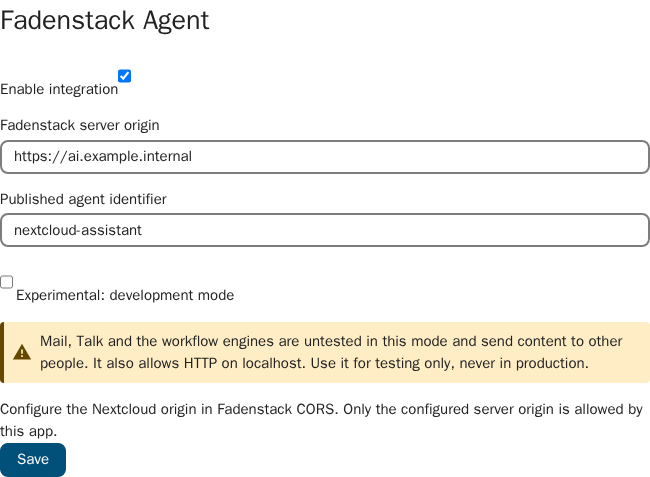

# Get started

To use the agent, your Nextcloud administrator installs the app and connects it to your organisation's Fadenstack
server, and the Fadenstack administrator gives you access to the agent. Then you open Files and sign in once per
visit.

## What you need

- A Nextcloud account on a Nextcloud 31 to 35 server where the administrator has installed and enabled the app.
- A Fadenstack account on your organisation's Fadenstack server, with access to the agent your administrator
  connected. The administrator gives it in the Fadenstack console (see
  [Agents and add-ins](../../administer/agents.md)).
- A current browser. The agent runs in the Nextcloud page; nothing is installed on your computer.

## Open the agent

1. Open **Files** in Nextcloud.
2. Select the Fadenstack button in the top bar.

The panel opens on the right. The first time in each visit it asks you to sign in: see [Sign in](sign-in.md).

You can also open it from a file: open a file's **Actions** menu and select **Ask Fadenstack**. The file is then
already included for your next message. In the full-screen Text editor, the button in the title bar opens the same
panel.

## The licence

The app is free software under the GNU Affero General Public License, version 3 or later (AGPL-3.0-or-later). You
can use it without paying for it. Your organisation's Fadenstack server and the models it offers are your
organisation's own.

## For administrators: install and connect the app {#install}

The Nextcloud administrator does this once for everyone.

1. In Nextcloud, open **Apps**, find **Fadenstack Agent** and select **Download and enable**.
2. Open **Administration settings**, then **Additional settings**, and find **Fadenstack Agent**.
3. Turn on **Enable integration**.
4. In **Fadenstack server origin**, enter your Fadenstack server's address, such as
   `https://ai.example.internal`. It must start with `https://`.
5. In **Published agent identifier**, enter the agent that the Fadenstack administrator published for Nextcloud.
6. Select **Save**. People reload Files to use the new settings.

On the Fadenstack server, the administrator publishes the agent and gives people access to it, and allows the
Nextcloud address to call the server from the browser.

??? info "More about the administrator's settings"
    - Each person's access to Nextcloud always comes from their own Nextcloud session. The app stores no
      administrator password and no shared account.
    - **Experimental: development mode** is off by default. It is for testing only, never for production: it unlocks
      tools for other Nextcloud apps (among them Mail and Talk, which send content to other people) and outside
      workflow services. It can also switch off the AI marks on files. See
      [Product information](product-information.md).
    - Disabling or removing the app erases its records of the agent's changes and the keys people stored for outside
      workflow services (see [Your data](your-data.md)). The organisation's settings stay. To remove the app and keep
      them, use `occ app:remove --keep-data fadenstack_agent`.

## When it does not work

| You see | What to do |
|---|---|
| **Ask your administrator to configure and enable Fadenstack Agent in Additional settings.** | The app is installed but not connected yet. Your Nextcloud administrator completes the steps above |
| No Fadenstack button in the top bar | The app is not enabled for you. Ask your Nextcloud administrator |
| **Connection unavailable** in **Assistant details** | The Fadenstack server address in Nextcloud's settings is not valid. Ask your Nextcloud administrator |

More in [When it does not work](troubleshooting.md).
