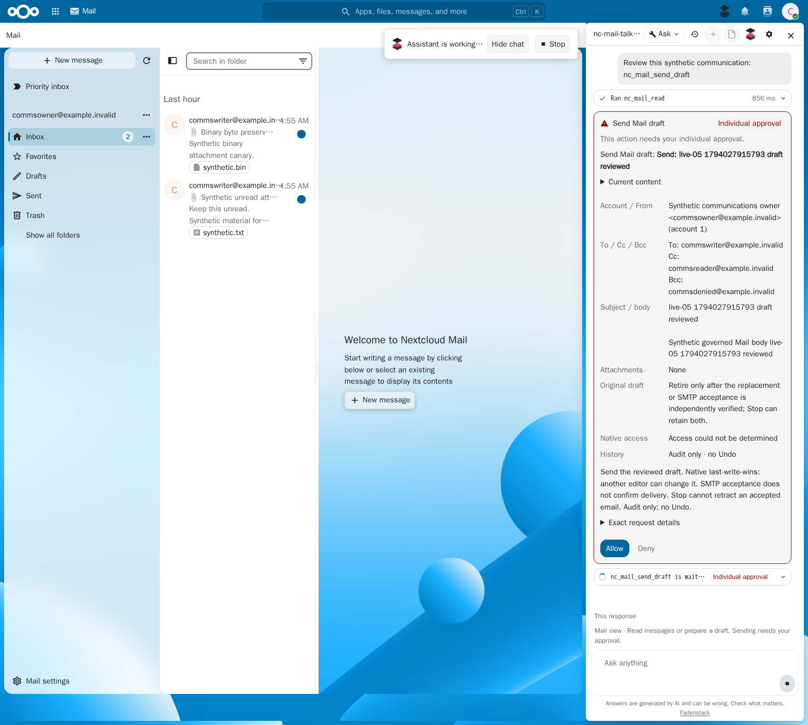
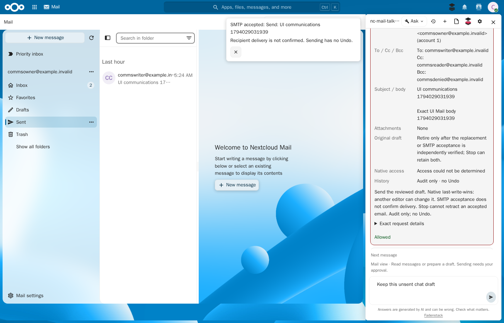
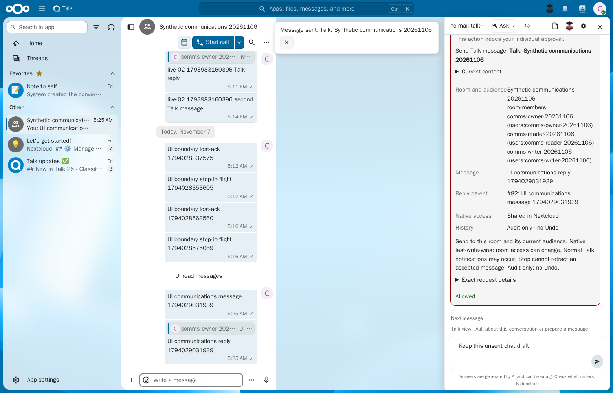
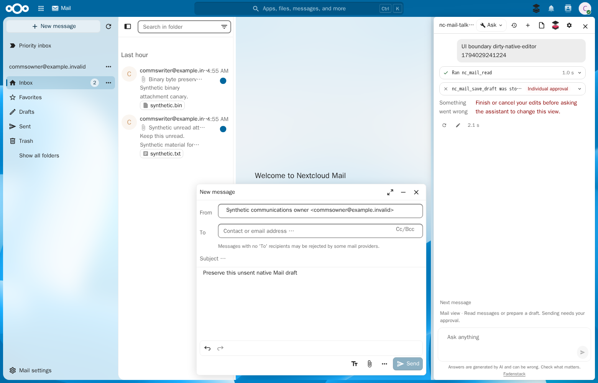

# Mail and Talk copilot

Open Mail or a Talk conversation, then open **Fadenstack Agent** from the header.
The native app stays on the left and chat stays on the right. Sign in with your
Fadenstack account; enterprise SSO is optional. Your Nextcloud session determines
which native accounts and rooms you can access. Nextcloud passwords and Mail
connection credentials are never sent to Fadenstack.

An administrator must enable the pilot provider and configure its account/room
scope. The published agent must also allow its tools. Supported native versions
for this pilot are **Mail 5.13.1** and **Talk 25.0.7**, tested on Nextcloud 35.0.2.
New providers are disabled by default.

| Tool | What it does | Approval / history |
|---|---|---|
| `nc_mail_read` | List scoped accounts/mailboxes; read up to 20 recent messages or one bounded message/draft | Read; leaves messages unread |
| `nc_mail_save_draft` | Save or update an unsent native draft | Individual approval; audit only |
| `nc_mail_send_draft` | Read the actual persisted draft, show its final contents, then send | Individual approval; no Undo |
| `nc_talk_read` | Read current members and up to 50 recent messages | Read; does not update read markers or presence |
| `nc_talk_send_message` | Send a message or reply in an authorized room | Individual approval; no Undo |

## Review before sending

Ask the assistant to read the scoped Mail account and prepare a draft. Saving a
draft never sends it. To send, ask it to read that persisted draft and send it
after approval. Check **From, To, Cc, Bcc, subject, body and attachments** in the
approval card. **Deny** makes no change.
Only that card's **Allow** button authorizes the action. Typing “Approved” in chat
does not grant native approval.

A confirmed Mail receipt means **SMTP accepted**. It does not guarantee recipient
delivery. Native editors can race with the assistant: the card discloses native
last-write-wins behavior. Observed changes invalidate the preview, but this is not
a lock against another editor.

For Talk, provide the room token from its `/call/<token>` URL when naming a room.
Check the room, member audience, message and reply parent. Normal native Talk
notifications can occur. The assistant observes Talk's existing history view;
it does not open a competing conversation session.

## Stop, drafts and inspection

The working overlay's **Stop** button uses the same Stop path as chat. It prevents
further agent dispatch. It cannot retract an email or message already accepted
by the native app. An interrupted Mail operation can leave an identifiable draft
or unscheduled outbox entry. **Agent actions → Inspect outcome** shows recorded
steps and known native identifiers without resending anything. Partial or unknown
completion is never a reason to repeat a send automatically.

Finish or cancel native edits before asking for a mutation. Dirty or unknown
editors require an explicit handoff/reload; the assistant preserves their contents.
An unsent chat draft remains in the composer during approved native updates.
Start a new chat when earlier native content changed and can no longer be safely
reauthorized for replay. A fresh read is required after access or policy changes.

On narrow screens, hide chat while editing in the native app. On desktop, Mail's
floating composer stays beside chat. Closing an editor alone does not prove its
changes were saved; use an explicit handoff/reload when the guard remains active.

Mail search covers the selected mailbox's latest 20-message window. The MIME
reader accepts at most 384 KiB raw messages, 64 KiB text/HTML bodies and 20
attachments of at most 256 KiB each. Signed/encrypted messages, aliases, inline
attachments, unsupported reply/receipt headers and attachments whose native copy
would change bytes require the native Mail editor. HTML previews are inert text.
Mail/Talk actions have an audit trail, without conflict-safe Undo or Redo.

## Administrator rollback

To stop new provider work, set `provider_writes_enabled` to `0`, or set the
Mail/Talk section's `enabled` to `false` while retaining its configured collections.
Keep the installed reader and background jobs so authorized audit and inspection
remain available. Re-enabling requires fresh previews; effects are never replayed.
Do not downgrade app files over newer journal data. A binary downgrade requires a
compatible reader or a consistent backup and a plan for effects already performed.
