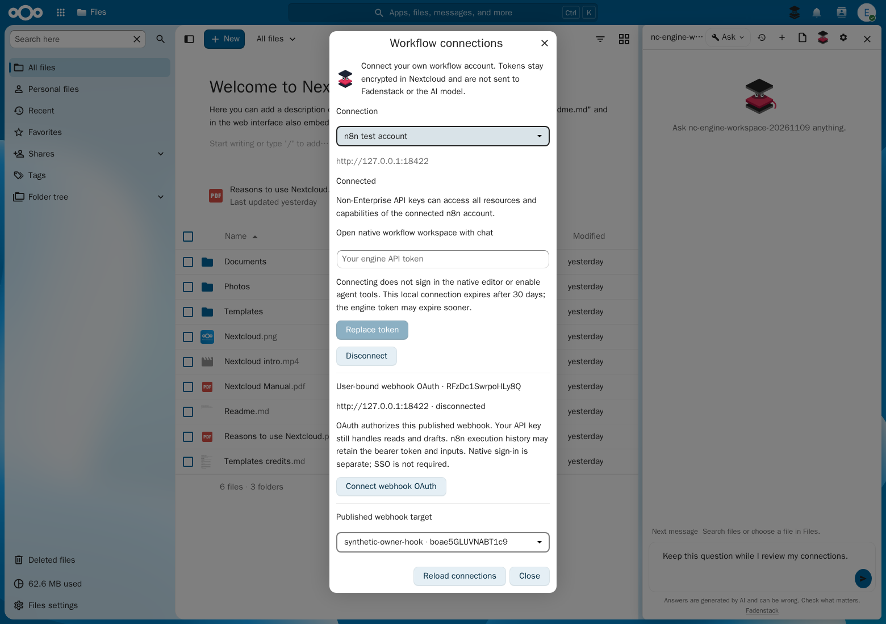
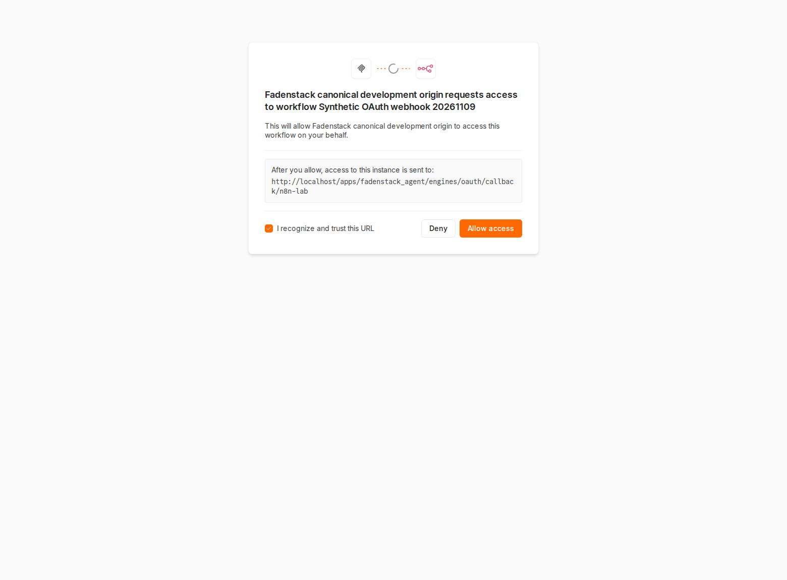
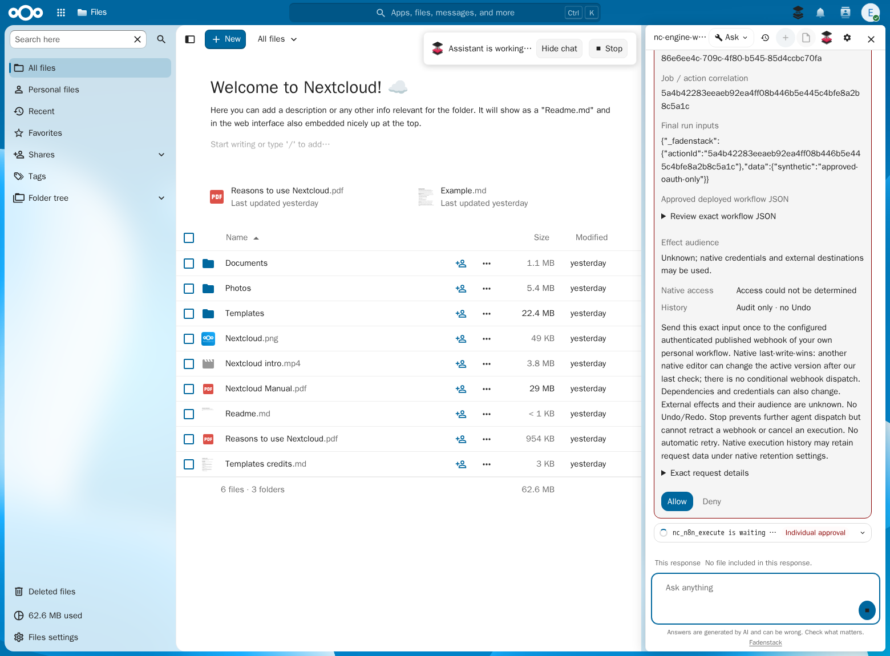

# Connect a user-bound n8n webhook

The experimental n8n 2.43.8 integration can authorize a configured published
webhook through your own n8n account. Enterprise SSO is not required. Your engine
password stays in n8n; OAuth tokens stay encrypted in your Nextcloud account.
The separate API key still handles workflow reads, inactive drafts and receipt
inspection.

1. Open **Settings → Workflow connections** in the assistant and select your
   connected n8n account.
2. Choose **Connect webhook OAuth**, then **Continue to n8n**. This opens a
   separate native tab and does not run the workflow.
3. Sign in to n8n. Review the client, workflow and exact Nextcloud return address.
   Check **I recognize and trust this URL**, then choose **Allow access**.
4. When Nextcloud confirms the connection, return to your original chat and
   choose **Reload connections**. Your unsent question is retained.

Connecting does not approve an execution. Ask the agent to run the configured
target, then review the native account, published version, exact inputs and
unknown external audience before **Allow**. **Deny** and **Stop** prevent new
dispatch. Stop cannot retract a webhook already sent. Execution has no Undo.

Use **Refresh OAuth grant** explicitly when required. Refresh or any connection
change invalidates earlier execution approvals. An uncertain exchange or refresh
is never repeated automatically: remove local OAuth access, then reconnect.
If you denied consent or closed the n8n tab, cancel the pending local connection;
it also expires after ten minutes. The native Deny button may return to n8n home
without a Nextcloud callback.

**Remove local OAuth access** stops new Nextcloud requests and clears pending
consent. It does not revoke tokens already issued by n8n. Revoke the app's access
in n8n separately to invalidate those tokens remotely. Native execution history
can retain bearer tokens and submitted inputs, including tokens from an earlier
refresh generation. Agent receipts exclude authentication headers and raw
execution inputs/outputs. Use **Agent actions → Inspect outcome** after an
interrupted receipt; do not repeat an uncertain run.

Administrator setup remains explicit and default off. Configure an own-personal
published workflow with one static POST Webhook node, version 2.2, **n8n User
Auth** (`n8nOAuth2`), execute-access enforcement and bearer mode. It must return
the execution ID and action correlation described in [workflow engines](workflow-engines.md).
The extension never inserts, publishes or activates the webhook.

The `engine_webhook_targets` entry uses `authentication: "oauth2"` instead of
`credentialId`. The matching `engine_oauth` setting is
`{"version":1,"clients":[{"targetId":"own-hook","issuer":"https://n8n.example.org","clientId":"registered-public-client"}]}`.
Register the exact native Nextcloud callback for the configured connection, such
as `https://cloud.example.org/apps/fadenstack_agent/engines/oauth/callback/my-n8n`.
Include the deployment prefix or `index.php` when generated by that installation.
Redirect differences are refused; the extension does not register clients on
every Connect or accept arbitrary authorization URLs.

Use distinct Nextcloud and engine browser hostnames; another port alone does
not isolate cookies. Production requires verified HTTPS. Independent native
sign-in and n8n's framing restrictions remain in place. API access, administrator
scope and Fadenstack approval are all required. OAuth does not grant tools,
credentials or access to another user's workflow. Broader roles, production TLS,
live-server and install/rollback acceptance remain release gates.
