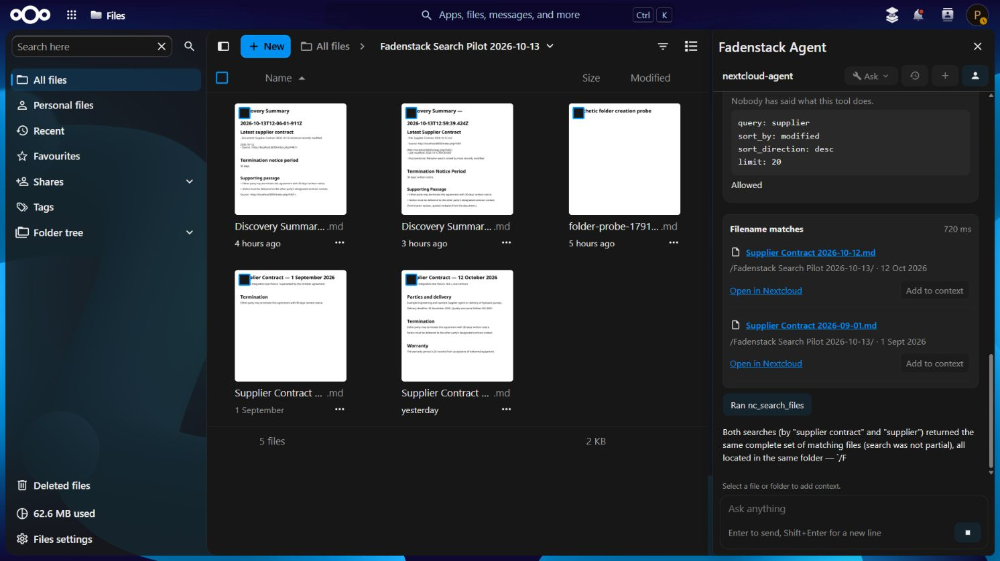
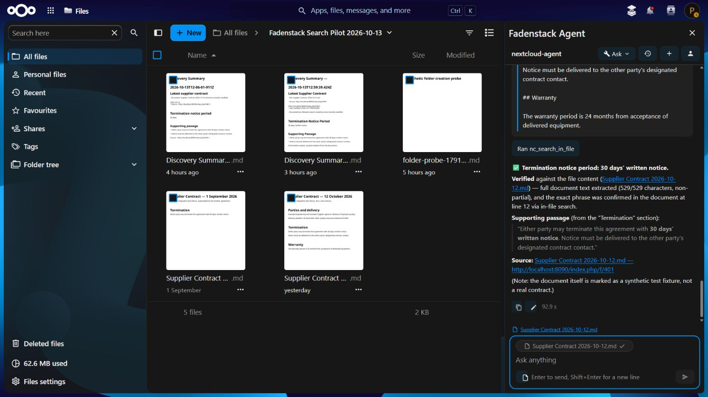
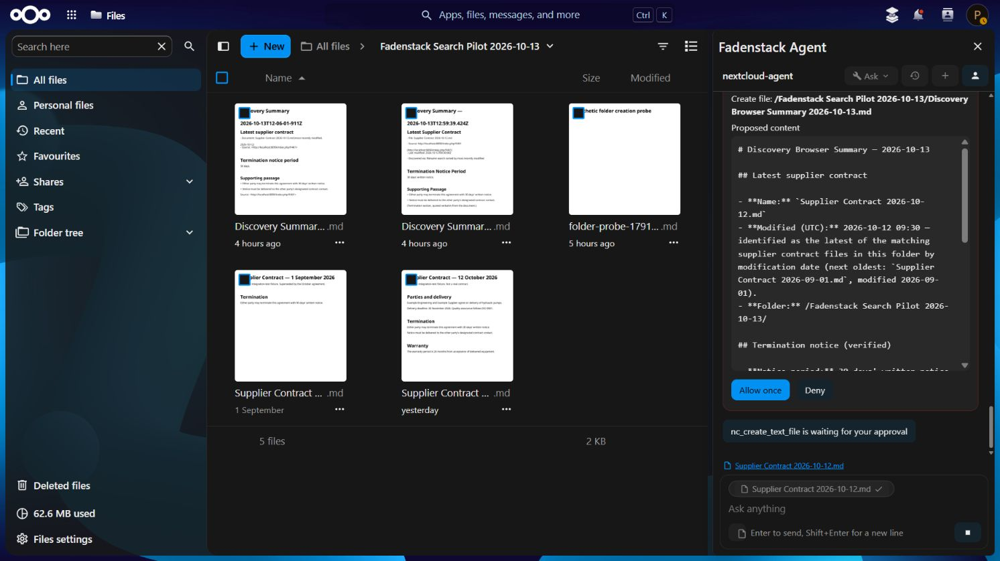
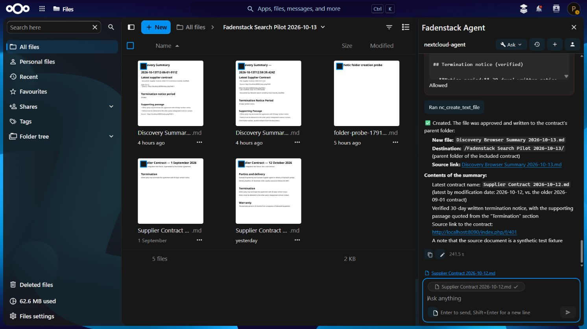
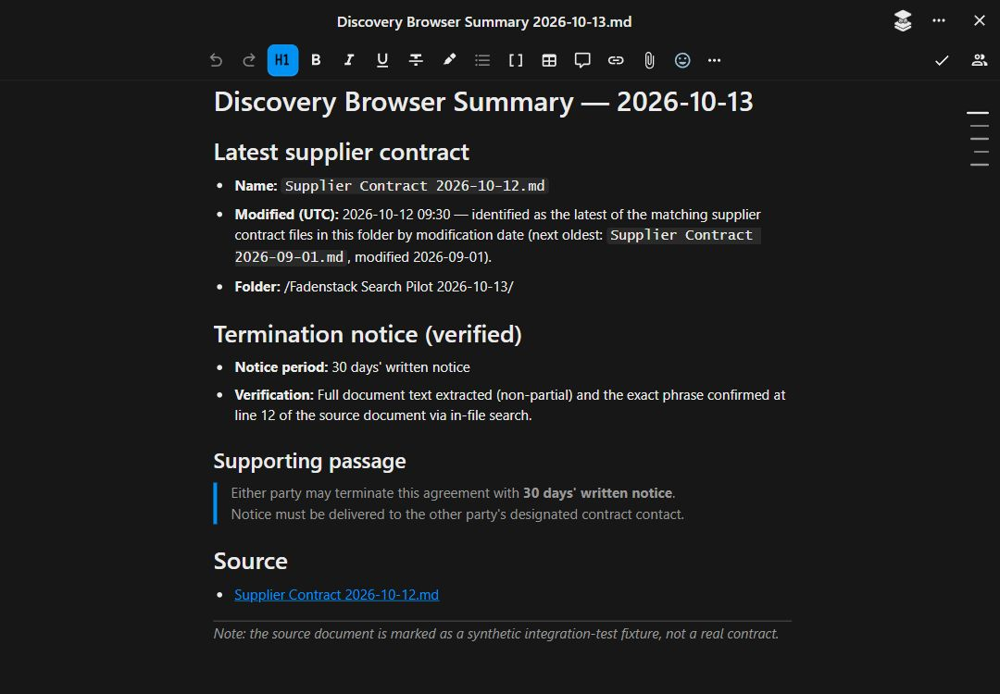
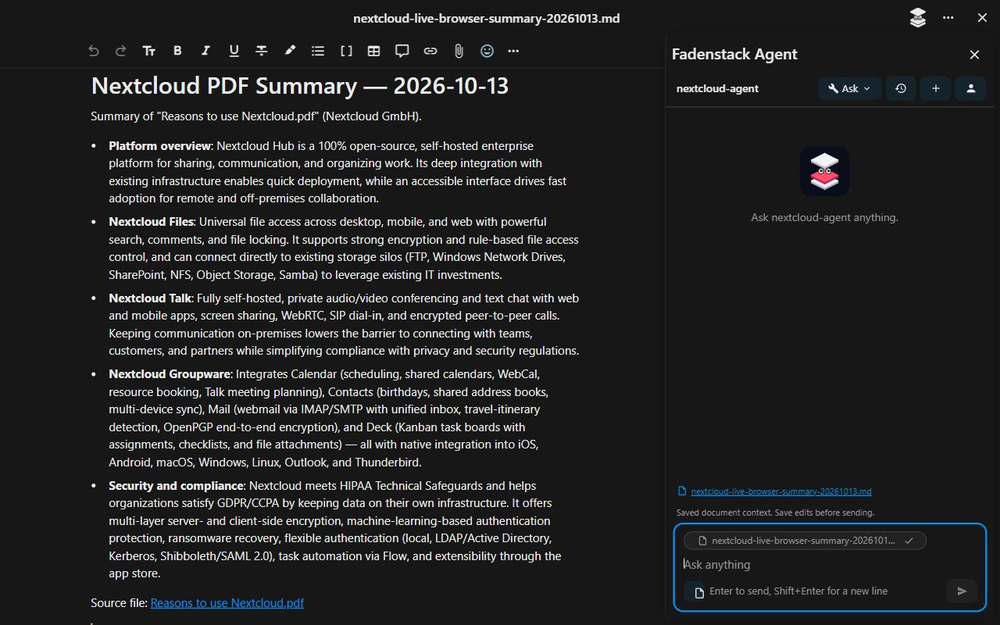
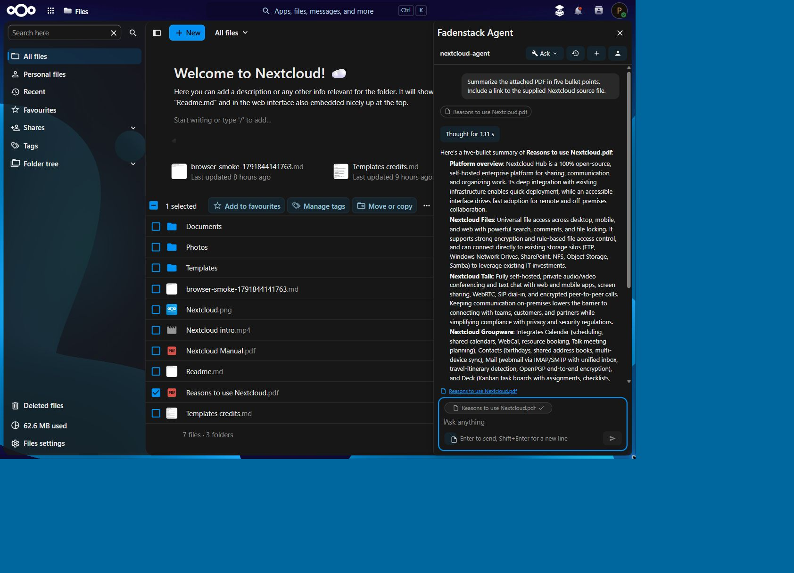
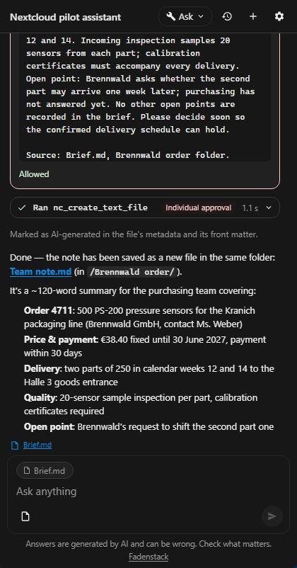
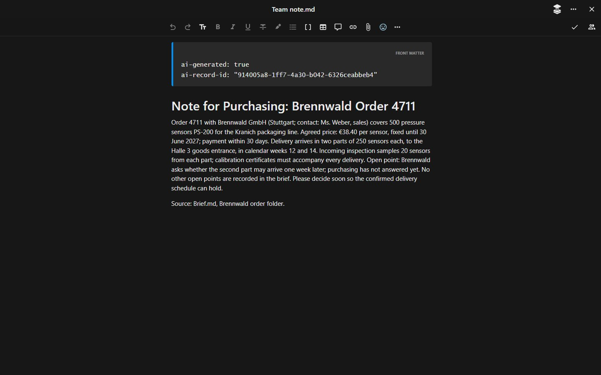
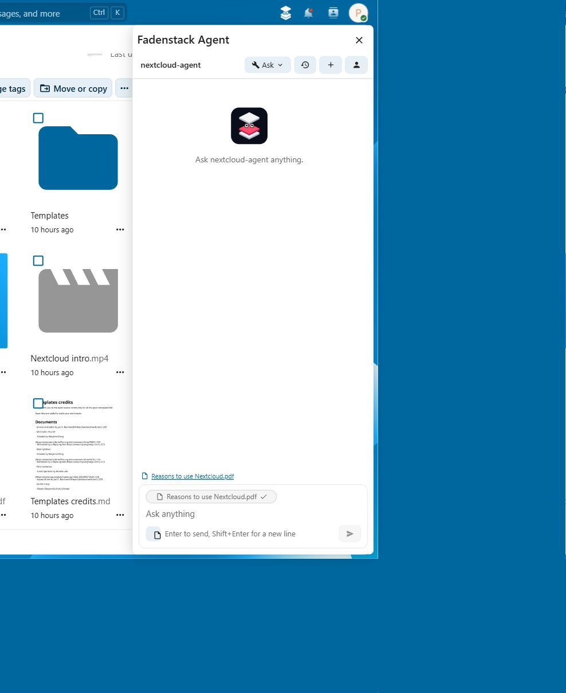

# Nextcloud 35 pilot screenshots

Captured against the real Fadenstack server on 13 October 2026. Documents are
public Nextcloud sample content and pilot results. No credentials are shown.

## Search workflow: live result cards and passage verification

Native filename searches return real authorized files with their canonical
Nextcloud links, dates and Add to context actions. The October contract was
identified as the latest by modification date.

Adding the latest contract to context and searching its contents confirmed one
exact 30-day notice passage at text line 12, followed by the sourced model answer.

## Search workflow: individual approval and completed write

The exact destination and full proposed Markdown were reviewed before Allow once.

The browser then completed the write and returned file 488's canonical link.

Independent authenticated read-back matched all 985 approved UTF-8 bytes exactly.
The returned link opened the saved summary in Nextcloud Text.

## Earlier SDK search workflow: actual saved summary

The real published agent discovered synthetic contract 401, verified its 30-day
termination passage, and created summary 455 after one exact approval through the
production SDK host. The screenshot shows the saved Nextcloud Text document and
its working source links. The separate complete browser workflow above closes
the acceptance described in [verification](verification.md).

## Full-screen Text editor

The mascot beside the native titlebar controls opens the shared drawer. The
attachment is the open saved Markdown, with its source link and saved-content hint.

The user's completed editor conversation, including an allowed `nc_read_file`
call and the final model response, closes the editor Send check.

## Live PDF summary

## Individual write approval

## Completed write

## Marked as AI-generated

Captured against the release test server on 19 October 2026. The panel after the
assistant created a note says how the file is marked:

The note opened in Nextcloud Text shows the mark in its front matter box:

## Light theme

