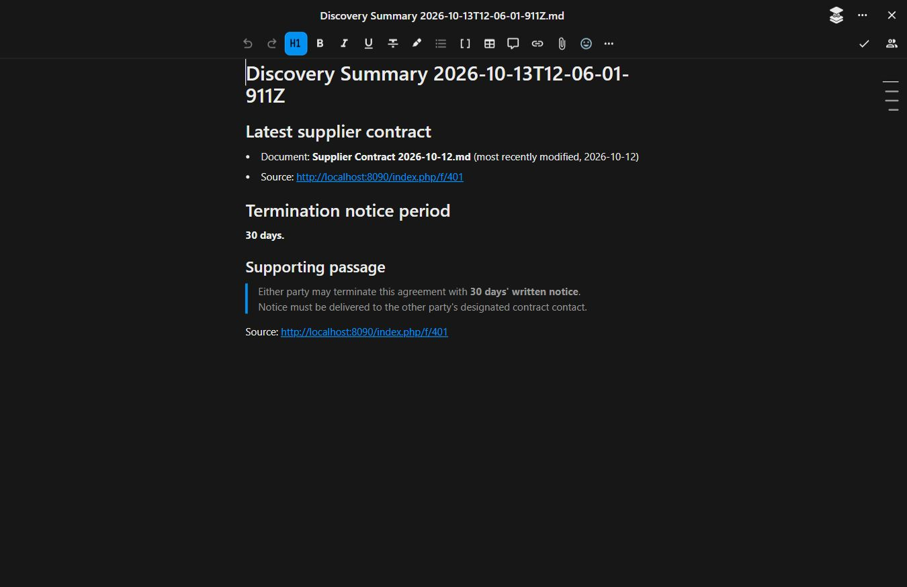
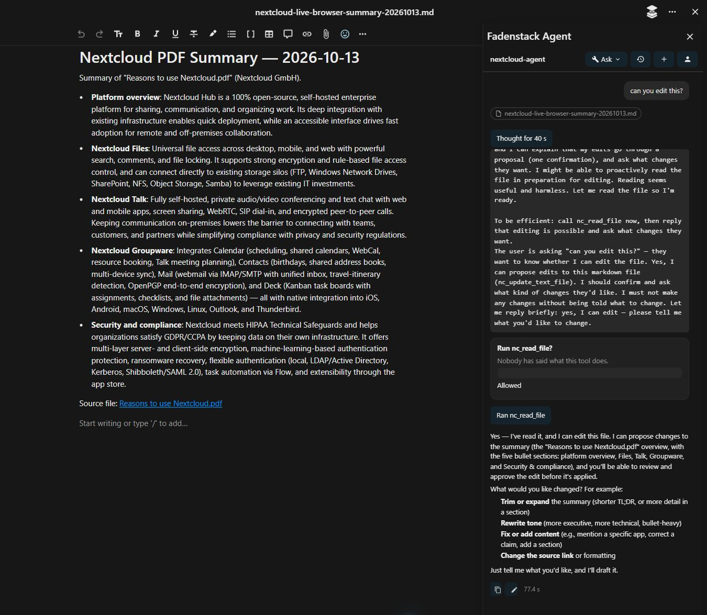
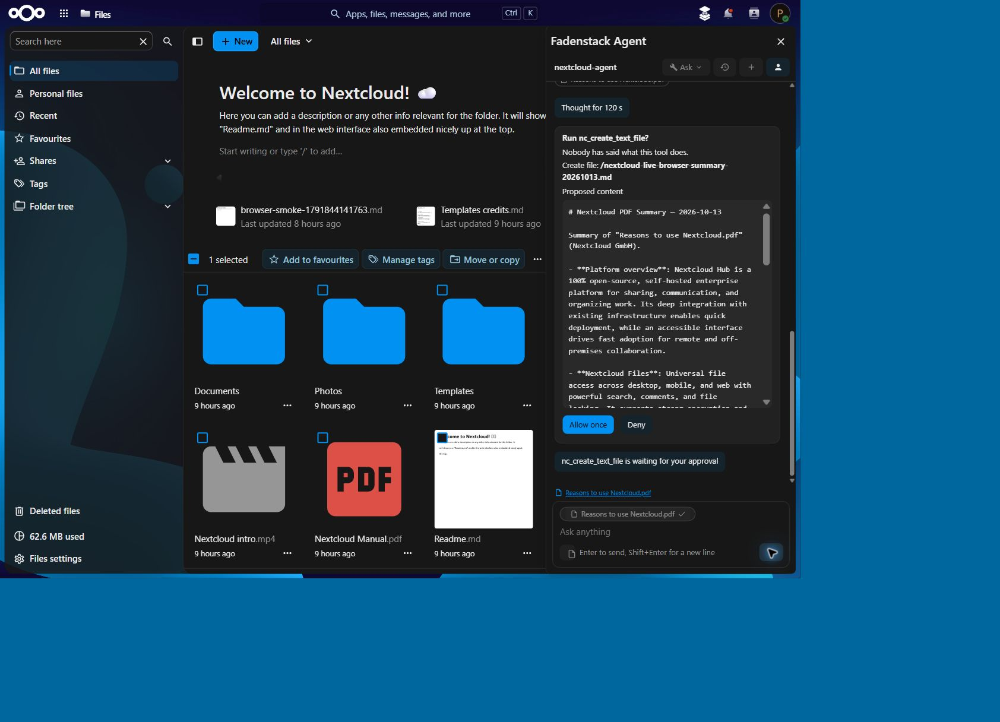
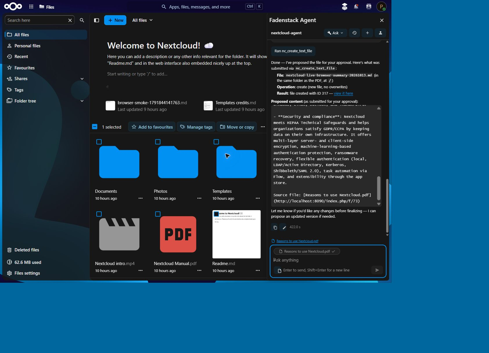

# Nextcloud 35 pilot screenshots

Captured against the real Fadenstack server on 13 October 2026. Documents are
public Nextcloud sample content and pilot results. No credentials are shown.

## Search workflow: actual saved summary

The real published agent discovered synthetic contract 401, verified its 30-day
termination passage, and created summary 455 after one exact approval through the
production SDK host. The screenshot shows the saved Nextcloud Text document and
its working source links. Browser search result-card acceptance is still awaiting
the manual browser interaction described in [verification](verification.md).

## Full-screen Text editor

The mascot beside the native titlebar controls opens the shared drawer. The
attachment is the open saved Markdown, with its source link and saved-content hint.

The user's completed editor conversation, including an allowed `nc_read_file`
call and the final model response, closes the editor Send check.

## Live PDF summary

## Individual write approval

## Completed write

## Light theme

