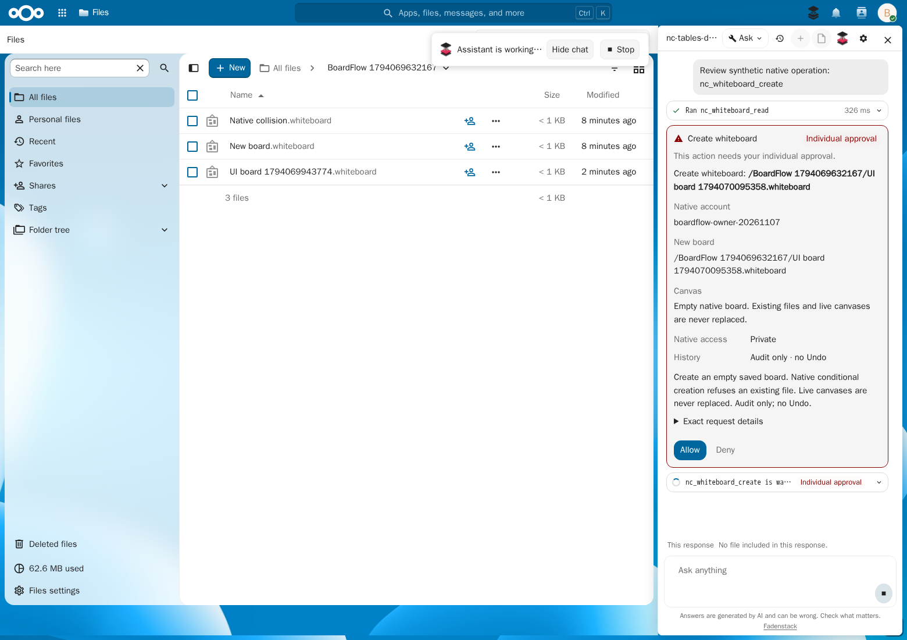
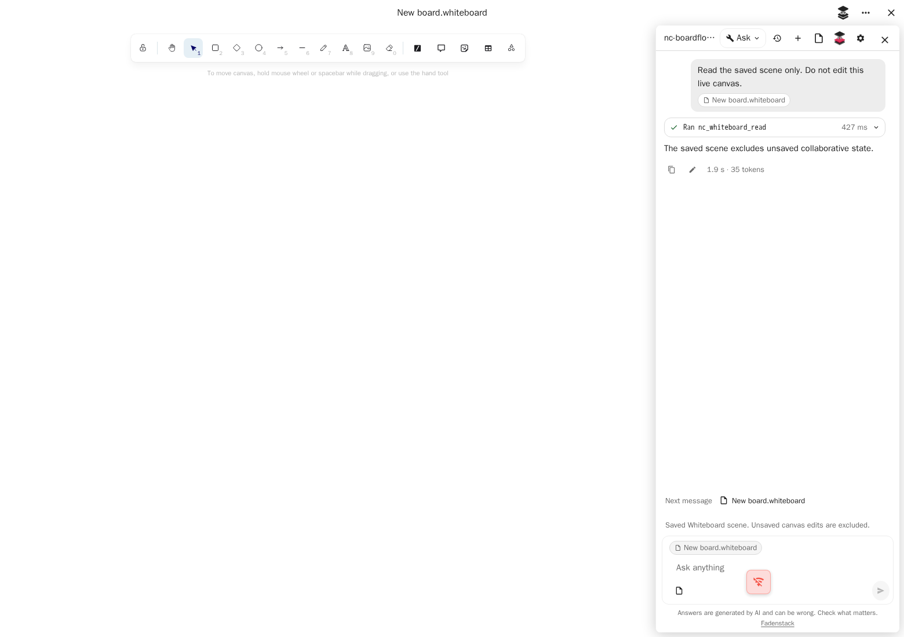
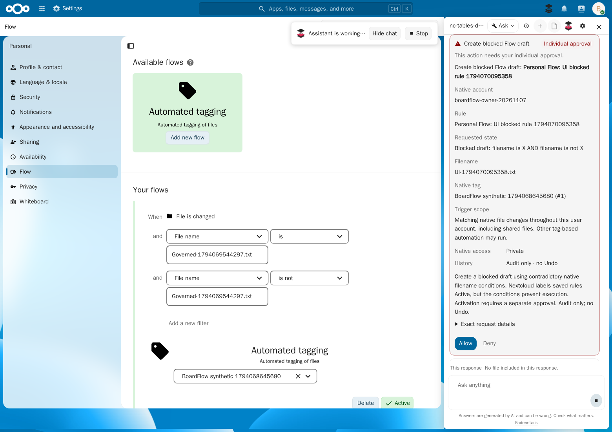

# Saved Whiteboard and personal Flow

These providers require administrator opt-in and the matching published agent
tools. The native app stays on the left and chat stays on the right. Nextcloud
checks your current native permissions for every read and write. Independent
Fadenstack sign-in works without enterprise SSO; your native password and session
cookie are never sent to Fadenstack.

| App | What the assistant can do | Limits |
|---|---|---|
| Whiteboard | Read a saved scene; create an empty new `.whiteboard` in an existing authorized folder | Saved files only. No live canvas edits, replacements or automatic overwrite. Up to 256 KiB / 1,000 elements per read. |
| Personal Flow | Read rules and assignable tags; create a blocked tagging draft; separately activate, block or delete a supported rule | Exact-filename tagging only. No administrator flows, arbitrary action classes or new tags. Native password confirmation may require a handoff. |

Selecting a Whiteboard includes its saved scene through the dedicated provider.
The context note explicitly excludes unsaved canvas edits.

Every mutation has an **Allow / Deny** preview showing the native account,
destination, payload, audience and limitations. Check these before allowing it.
**Stop** prevents further agent dispatch; an in-flight request or an already
triggered automation can still complete. Do not repeat an uncertain action.
Use **Agent actions** to inspect its recorded outcome. These actions have an
audit trail and no certified Undo or Redo.

A blocked Flow draft uses two native conditions: **filename is X AND filename
is not X**. Both cannot match together. Nextcloud still labels a saved rule
“Active”; this is not a native disabled flag. Keep both conditions until a
separate activation approval removes the blocking condition. Native edits can
change the guard. Unsupported recipes require the native editor.

An active rule can tag matching file changes throughout your native account,
including shared files. Tags may trigger other configured automations. Blocking
or deleting a rule does not reverse previous tag effects. Native Flow uses
last-write-wins: the final recheck detects already-observed changes but does not
lock out native editors.

Clean native views refresh through the agent-owned child while preserving the
chat and its unsent draft. Dirty, unknown or inaccessible editors need an
explicit handoff. Save or cancel your native edits before acknowledging a
refresh. Creating a saved board does not provide Whiteboard's collaboration
server; normal native canvas saving depends on that separate service.

The tested native versions are Whiteboard **2.1.2**, workflowengine **3.0.0** and
Files automated tagging **6.0.1** on Nextcloud **35.0.2**. Providers stay default
off. Their bounded runtime tests do not remove the release or named-pilot gates.
