# Workflow engine connections, reads, drafts and approved runs

For step-by-step approval, Stop and read-only recovery, see
[Run a workflow and inspect its outcome](workflow-execution.md).

For a configured editor on the left with chat on the right, see the
[native workflow workspace](engine-workspace.md). Its explicit pause handoff
retains an opaque editor; child-only reload is user requested. Native framing
and browser sign-in restrictions still apply, including n8n's separate-tab
fallback. This does not enable automatic clean-editor refresh.

This experimental slice reads saved workflows and creates new private drafts in Windmill **1.841.0** and n8n **2.43.8**
workflows through your own engine account. Your administrator must configure
the endpoint, opt in to provider reads and publish the matching agent tools.
The engine and Nextcloud integration apps need no source changes.

1. Open the assistant's **Settings → Workflow connections**.
2. Select the administrator-configured connection and paste your own engine
   API token. **Connect** verifies access before saving it encrypted in your
   Nextcloud account. The token field clears after submission.
3. Ask: “Find my connected workflow engines and list their saved workflows.”
   Ask for a particular saved workflow to read its definition.
4. Use **Disconnect** to remove access. An administrator endpoint change or
   the local 30-day expiry requires an explicit reconnect.

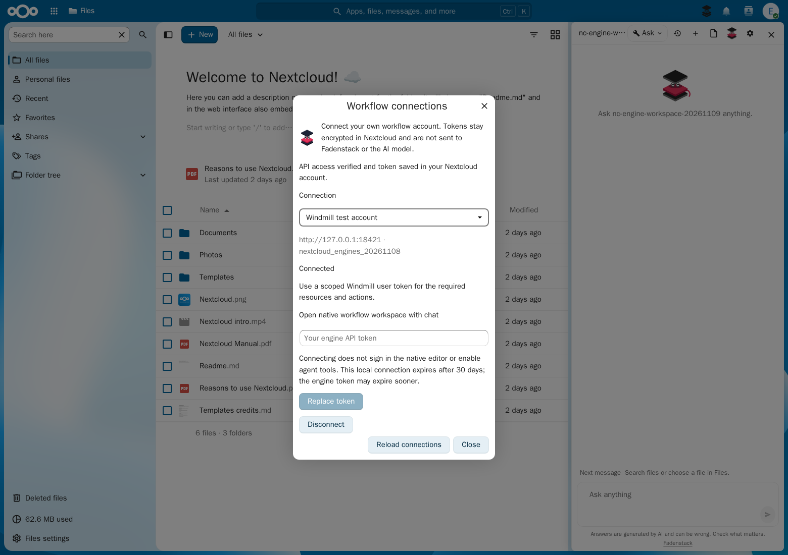

### Token capabilities, scopes and truthful refusals

Each engine connection enforces current native token authority throughout its lifecycle:
- **API principal identification**: On Connect, the extension queries the engine to resolve and display the authenticated API principal (e.g. `admin@windmill.local` or `alice@n8n.local`). This identity is displayed on the connection badge and in the native workspace.
- **Read-only tokens**: A token lacking write or execution permissions (such as a Windmill viewer token) is verified and connected for reads, but truthful capability refusals block flow execution and draft creation with explicit audit records.
- **Revoked or expired credentials**: When a token is revoked or expires, attempts to read, draft, or run trigger clean unbinding without stranding credential removal.
- **n8n Community broad keys**: Non-Enterprise n8n API keys have full instance-wide access. The connection truthfully discloses this broad scope rather than falsely claiming fine-grained scoping. In Community edition, personal workflows belong strictly to their creator; User 2 cannot read or copy User 1's personal workflows even if the underlying key could reach them.
- **Opaque API keys**: If an n8n API key does not permit verifying the underlying user account identity, draft creation and workflow mutations are refused with an explicit disclosure (`account ownership unverifiable`).

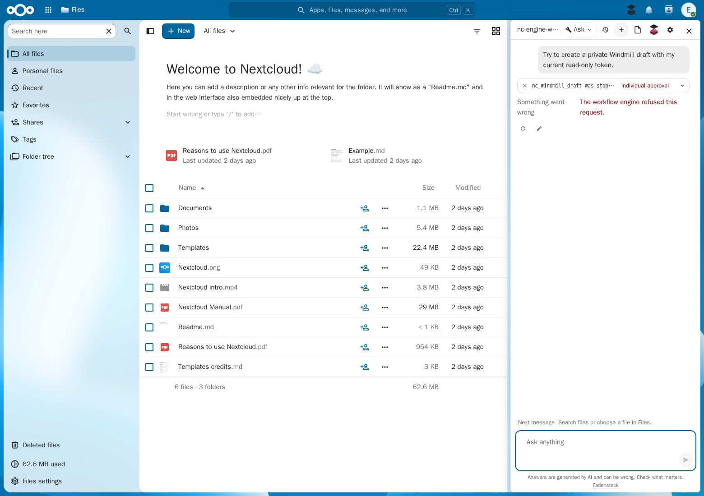

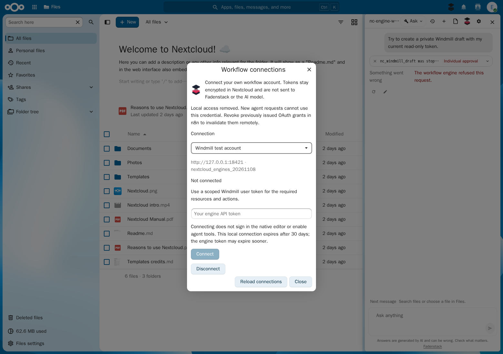

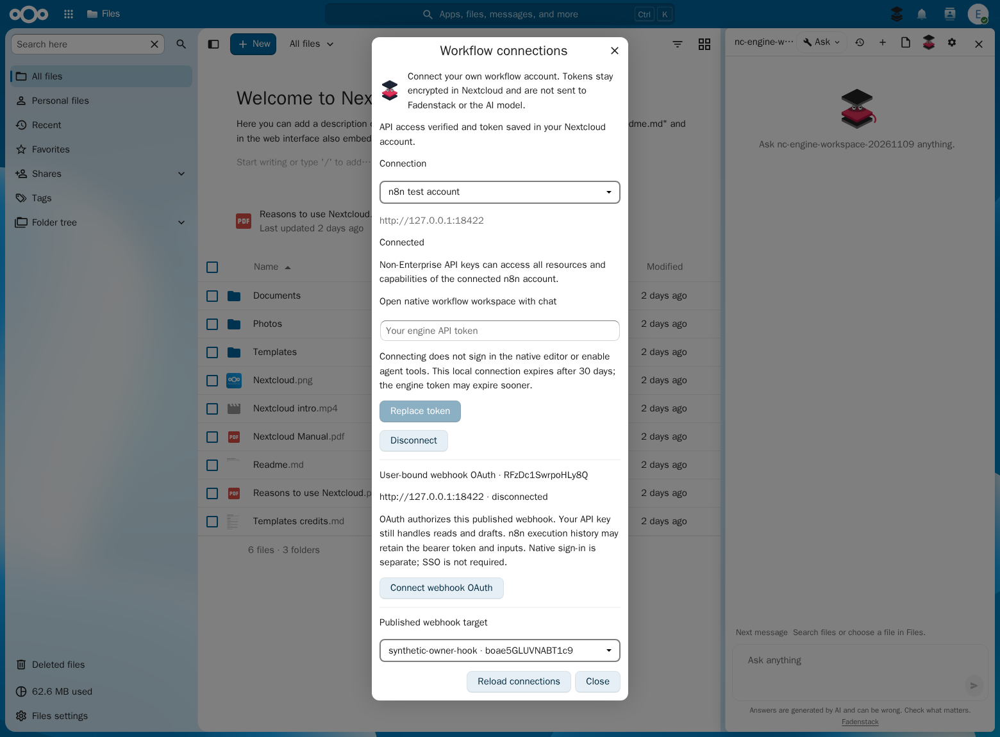

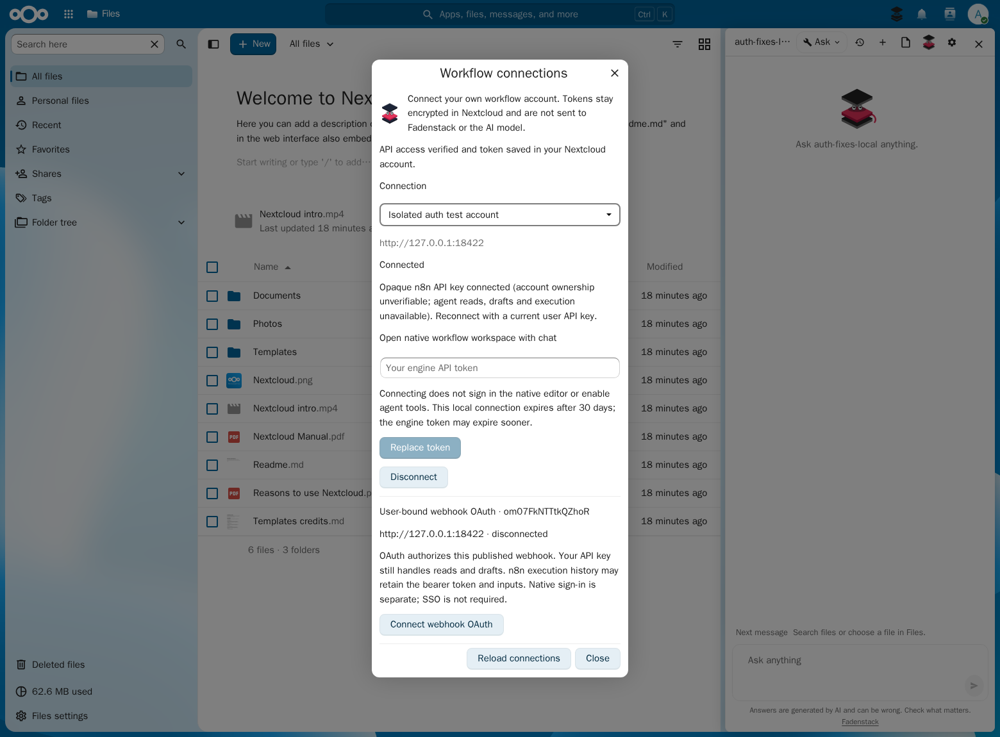

Separate Fadenstack sign-in works without enterprise SSO. Your Nextcloud
password, native session cookie and engine connection token stay outside
Fadenstack. Connecting the API does not sign in an embedded native editor.
Non-Enterprise n8n keys can be broader than this assistant's allowed tools.

Each list returns at most 20 workflows. Definitions are bounded to 128 KiB
and 200 top-level nodes/modules. Reads use current engine permissions and
retain graph fields, credential references and existing origin metadata.
Graphs can contain inline inputs and code. Credential stores and n8n pinned
execution samples are excluded. Unsaved editor changes are outside the read.

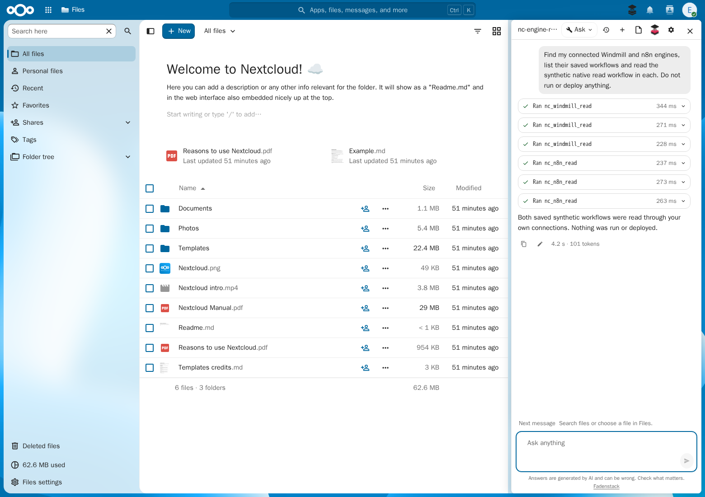

The shared working overlay and composer both provide **Stop**. A late native
read response is discarded after Stop. Stop does not cancel an external job
that was already running.

Draft creation needs a separate administrator write and movement grant and a
published draft tool. Ask for a **new private draft**, then review the accounts,
destination and exact JSON before **Allow**. Windmill saves an own-user draft
without deploying a flow. n8n creates an inactive workflow with a unique name;
subworkflow callers and MCP availability are disabled. Existing graphs are not
replaced. The engine enforces current creation permissions when called.

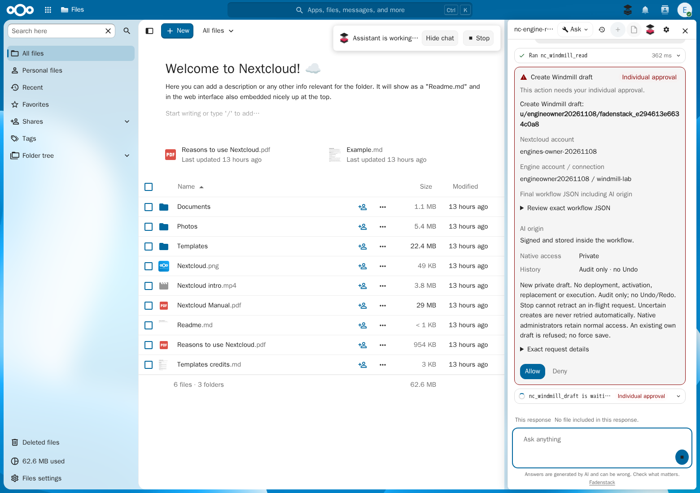

To copy an existing workflow, ask for a **new private inactive copy** and the
changes you want. The assistant reads the saved source first. For a known
Windmill private draft, it selects that own-user draft explicitly; it does not
silently substitute the deployed flow.

Review **Copy source / kind**, **Copy source revision** and the final workflow
JSON before **Allow**. The extension copies supported draft fields directly
from the native source, retains prior origin as unverified history and signs
the new content. It preserves fields the assistant did not replace, including
graph details and credential references. A requested top-level object or node
array replaces that whole field; it is not a nested merge. Runtime IDs,
ownership, sharing, tags and execution samples are not copied. Unrecognized
source root fields are refused for native review.

Changes or lost access observed before approval or dispatch require a fresh
read and preview. Native editors are not locked: the new copy always uses the
approved snapshot, and the original workflow is never written. Copying grants
no credential access, deployment or execution. Stop and audit-only history
work as for other draft creates.

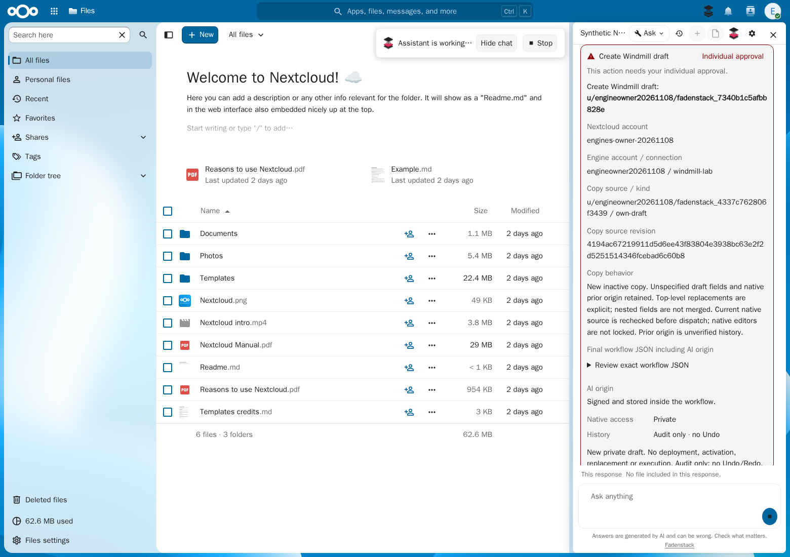

AI origin is written inside the workflow before approval. Windmill uses
`schema.x-fadenstack-provenance`; n8n uses a hidden metadata comment in the
first existing node's notes, preserving user notes and adding no node. New
n8n drafts need 1–200 native nodes. Older description markers remain readable.
The signed record is checked against the configured publisher's signing key.
This marks origin; it does not grant access or certify legal compliance.
See [AI origin, placement reports and export limits](workflow-provenance.md)
for the embedded carriers, readback checks and behavior after native edits.

Use **Agent actions → Inspect outcome** after an interrupted acknowledgement.
The generated draft reference identifies the attempt. Inspection sends no
write. Drafts have an audit trail and no Undo/Redo. Never repeat an uncertain
create: Stop can arrive after the engine already saved it.

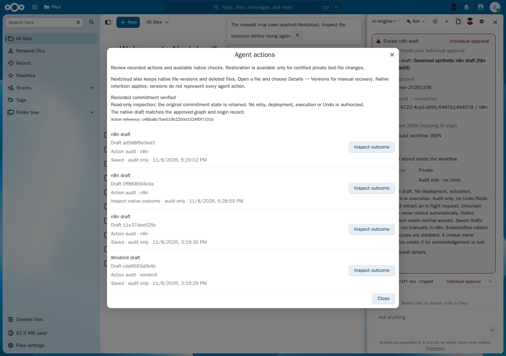

Windmill execution is separately gated. The administrator must explicitly list
the own-user flow in `engine_run_targets`, grant `nc_windmill_run`, enable native
writes and allow the configured source class to move to the **unknown** audience.
For example, the execution-target setting can contain
`[{"connectionId":"my-windmill","reference":"u/alice/example"}]`.
An API connection alone grants no run access. The native token still needs
permission to run that flow; restricted-token capability acceptance remains a
release gate.

Ask to run the configured deployed flow once. Review its native account,
version, exact JSON inputs and graph before **Allow**. A changed deployed flow
invalidates the preview. The assistant never deploys, replaces or activates it.
Dependencies and native credentials can change independently of that version.

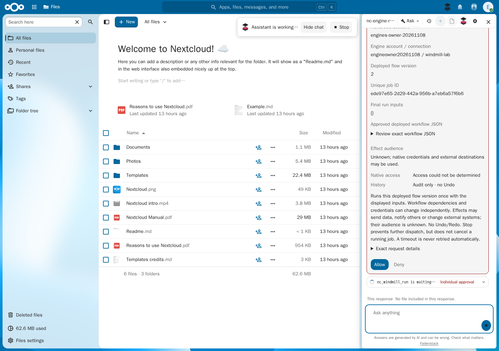

The receipt verifies a unique **job dispatch**, and reports whether the engine
says it is queued/running, succeeded, failed or cancelled. Native job success
does not independently verify external effects. Stop does not cancel an
already-dispatched job, and partial external effects have no Undo.

Use **Agent actions → Inspect outcome**, or ask to inspect the recorded
`actionId` with `nc_windmill_read`. This reads the known job without another
run. No code, logs, job results or credential values are returned. A missing
job or lost acknowledgement stays uncertain; never repeat the run automatically.

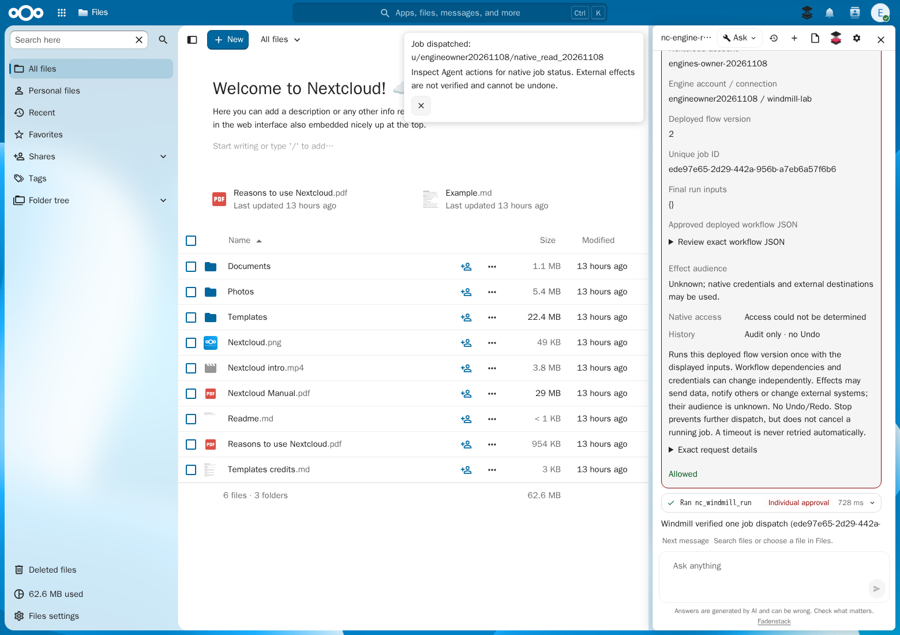

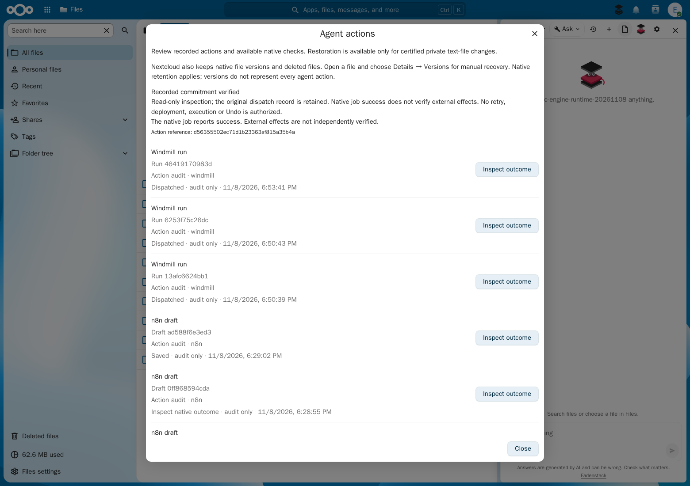

n8n execution uses a separate **published webhook target** configured by your
administrator. It must belong to your connected native user's personal workflow.
The tested subset has one static POST Webhook node (version2), Header Auth,
an empty options object and a response containing its native execution ID and
the supplied action correlation. The assistant never inserts a webhook or
publishes/activates a workflow.

In **Workflow connections**, select n8n and the published target. Save its
dedicated **X-Fadenstack-Workflow-Key** secret. This is separate from the n8n
API key. Both stay encrypted under your native Nextcloud account; no SSO is
required. Saving a webhook key sends no test execution and does not claim
that the key has been verified. Replacing the API token removes its stored
webhook keys. Disconnect removes both kinds of credential.

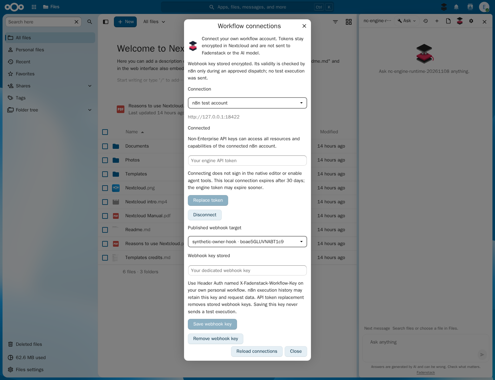

The tested native Webhook node retains the authentication header in its own
execution history. Use a dedicated key for this personal workflow. Native
administrators and authorized execution-history readers may see it. Agent
status responses exclude headers, inputs, outputs and credentials.
Alternatively, the configured version-2.2 **user-bound OAuth** webhook uses
native consent, an encrypted own-user grant and the same individual execution
approval. See [OAuth connection and removal](n8n-oauth.md). The Header Auth
path remains supported; OAuth never silently falls back to it.

Ask to run the configured target once, then review the account, published
workflow/version, credential reference, exact request and unknown effect
audience before **Allow**. Native last-write-wins applies: the active version
can change after our final check. A mismatched native execution readback stays
unknown, with no automatic resend. Execution has no Undo.

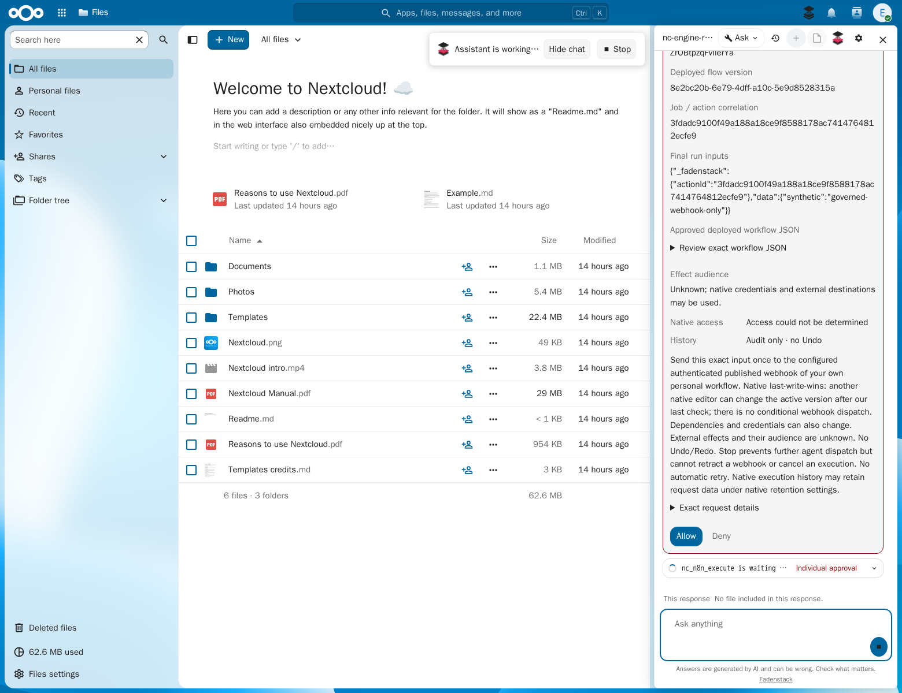

The response must contain `{"executionId":"<native-id>","correlation":"<action-id>"}`.
The request body is `{"_fadenstack":{"actionId":"<action-id>"},"data":{...}}`.
Native execution readback must match that body and the approved published version.
This contract is required for verified receipts; an arbitrary webhook response
is insufficient. Workflows can fail after producing partial external effects.

Use **Agent actions → Inspect outcome**, or `nc_n8n_read` with the recorded
`actionId`. Read-only recovery checks a complete collection of at most20
native executions. Busy, pruned, missing or ambiguous history stays unknown;
it never authorizes another webhook. Stop prevents future dispatch, and cannot
cancel an already accepted execution.

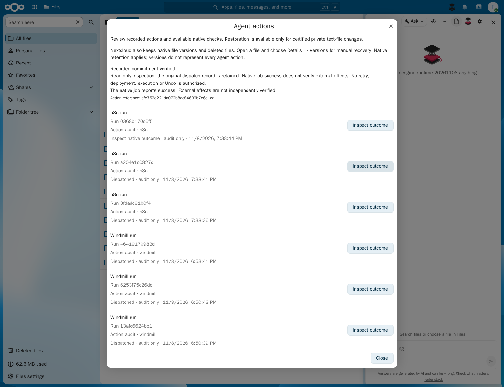

All six engine tool runtimes and the bounded own-user OAuth connection/dispatch
path exist locally. Automatic authenticated-editor refresh, broader role/fault
tests, production OAuth/TLS and release acceptance remain open.
Providers remain experimental and default off. Live read/draft and bounded
Windmill/Header Auth execution evidence is available in the
[execution acceptance report](https://github.com/fadenstack/fadenstack-dev/blob/master/nextcloud-engine-live-execution-2026-11-09/README.md).
Broader roles, production OAuth/TLS, authenticated editor refresh and package
lifecycle acceptance are separate gates. Earlier illustrated research lives in the
[development report](https://github.com/fadenstack/fadenstack-dev/blob/master/nextcloud-agent-engines-2026-11-08/N8N_EXECUTION_CHECKPOINT.md).
