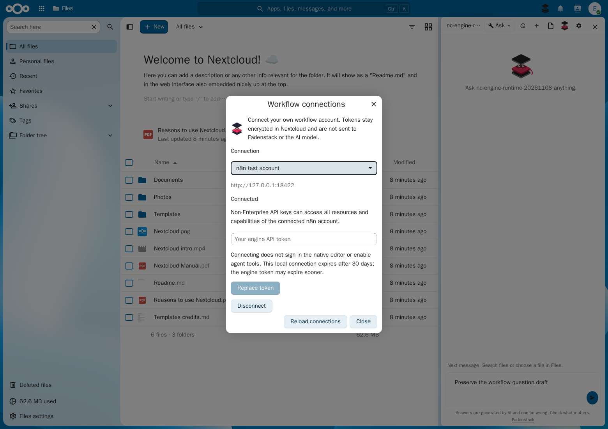
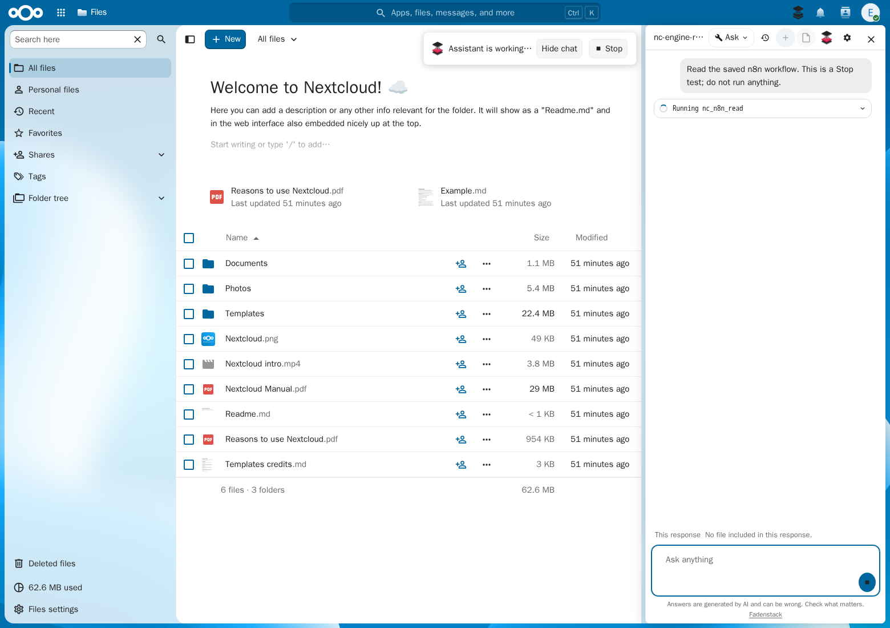

# Workflow engine connections and reads

This experimental slice reads saved Windmill **1.841.0** and n8n **2.43.8**
workflows through your own engine account. Your administrator must configure
the endpoint, opt in to provider reads and publish the matching agent tools.
The engine and Nextcloud integration apps need no source changes.

1. Open the assistant's **Settings → Workflow connections**.
2. Select the administrator-configured connection and paste your own engine
   API token. **Connect** verifies access before saving it encrypted in your
   Nextcloud account. The token field clears after submission.
3. Ask: “Find my connected workflow engines and list their saved workflows.”
   Ask for a particular saved workflow to read its definition.
4. Use **Disconnect** to remove access. An administrator endpoint change or
   the local 30-day expiry requires an explicit reconnect.

Separate Fadenstack sign-in works without enterprise SSO. Your Nextcloud
password, native session cookie and engine connection token stay outside
Fadenstack. Connecting the API does not sign in an embedded native editor.
Non-Enterprise n8n keys can be broader than this assistant's allowed tools.

Each list returns at most 20 workflows. Definitions are bounded to 128 KiB
and 200 top-level nodes/modules. Reads use current engine permissions and
retain graph fields, credential references and existing origin metadata.
Graphs can contain inline inputs and code. Credential stores and n8n pinned
execution samples are excluded. Unsaved editor changes are outside the read.

The shared working overlay and composer both provide **Stop**. A late native
read response is discarded after Stop. Stop does not cancel an external job
that was already running.

Draft creation, execution, engine-editor refresh and their audit receipts are
still being implemented. This checkpoint exposes only `nc_windmill_read`
and `nc_n8n_read`; it offers no engine Undo/Redo and is not a release acceptance
claim. Illustrated research and test evidence live in the
[development report](https://github.com/fadenstack/fadenstack-dev/blob/master/nextcloud-agent-engines-2026-11-08/READ_CHECKPOINT.md).
