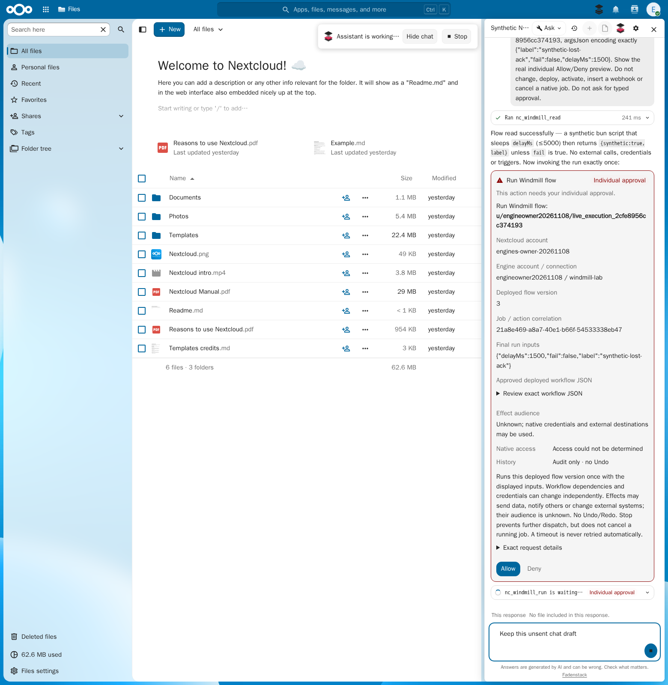
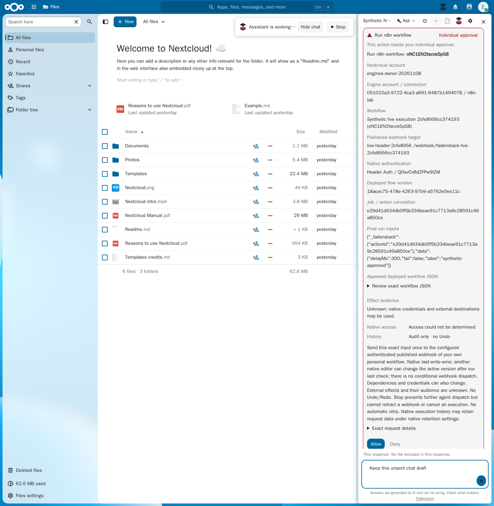
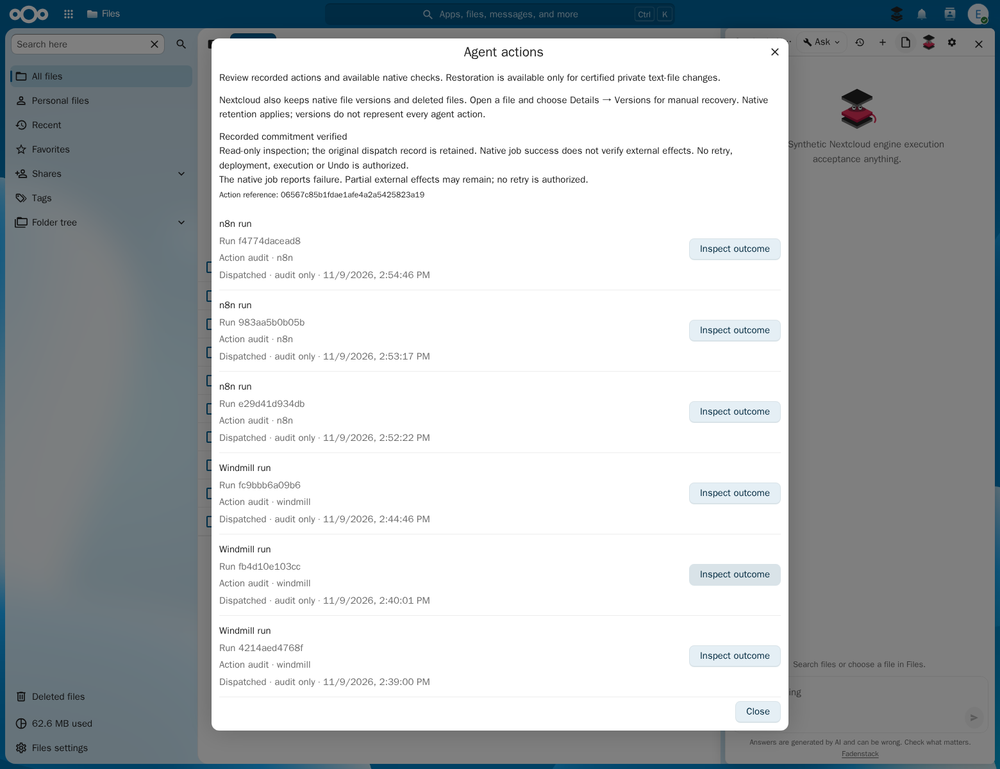
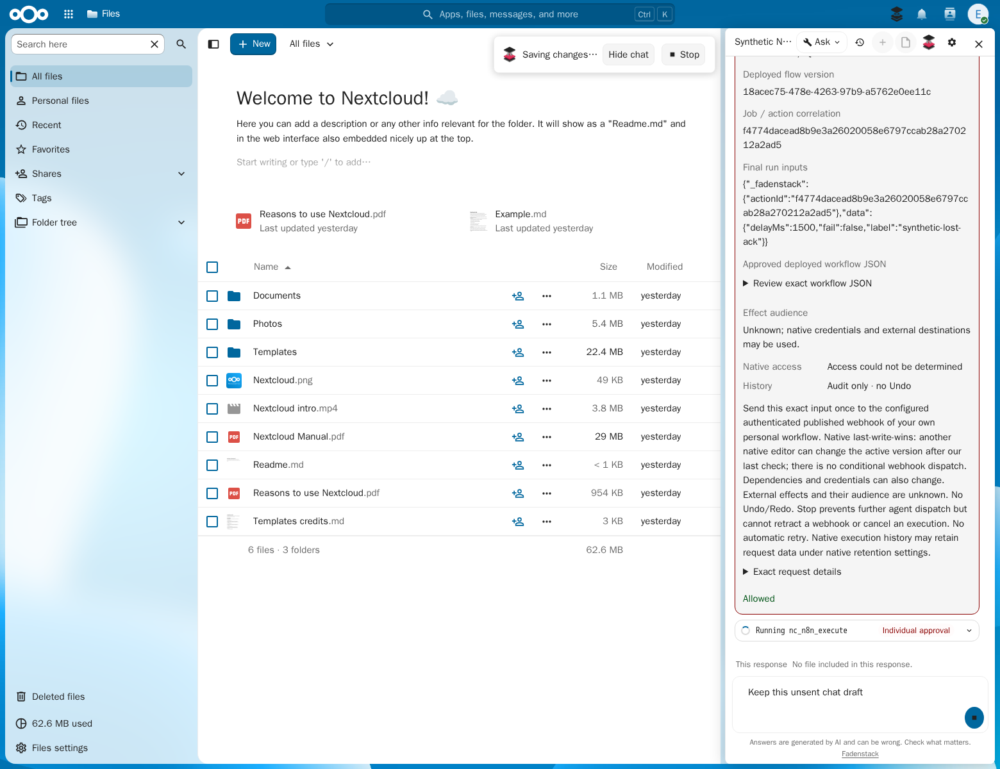
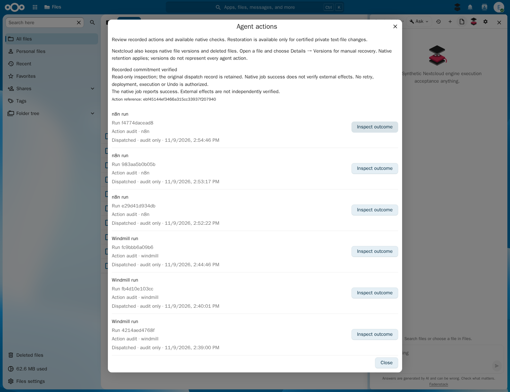

# Run a workflow and inspect its outcome

Your administrator enables each execution target separately. Connect your own
engine account in **Settings → Workflow connections**. n8n also needs the
configured webhook's dedicated key or supported [OAuth connection](n8n-oauth.md).
No enterprise SSO is required. An API connection does not sign you into the
engine's native editor; use its separate native sign-in when needed.

Ask the assistant to read the saved workflow, then run the configured target
**once** with your inputs. Review the native account, published version, exact
inputs and effect audience before **Allow**. **Deny** sends no execution.
The assistant does not deploy or activate workflows or insert webhook nodes.

The initial receipt verifies a native **dispatch**. The job may still be running.
Open **Agent actions → Inspect outcome** to read its current native state, or ask
to inspect the recorded action ID. This inspection sends no new run. A native
success does not independently establish recipient delivery or other external
effects. Failed workflows may have partial effects; they are not retried
automatically and have no Undo/Redo.

**Stop** prevents further agent dispatch. It cannot retract an accepted webhook
or cancel a job already running in the engine. An execution can be accepted
before its acknowledgement reaches your browser. If the response is interrupted,
inspect the original action instead of asking the assistant to run it again.

If chat answers without checking the job, use **Inspect outcome** for a direct
native check. If inspection cannot confirm the execution, keep the outcome
uncertain and check the native application. Missing or pruned history is not
permission to repeat an action.

n8n's native execution history may retain webhook inputs and authentication
headers. Use the dedicated personal-workflow credential and native retention
controls. Fadenstack does not receive that native credential; agent status
results exclude the raw headers, inputs, outputs and code.

The [engine guide](workflow-engines.md) describes supported versions and limits.
For an editor beside chat, use the [workspace](engine-workspace.md) and its
explicit dirty-editor handoff. Native framing restrictions remain in place;
automatic authenticated-editor refresh is a separate acceptance gate.
