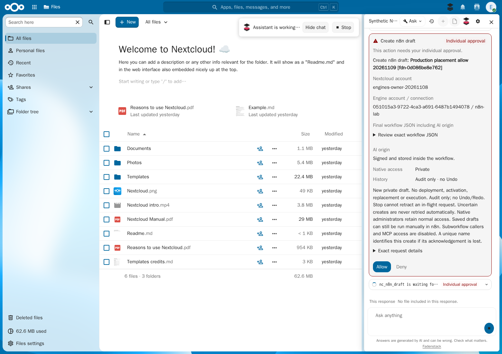

# AI origin in workflow drafts

The assistant writes origin metadata **inside the workflow before you approve
it**. Review the native account, destination and **Review exact workflow JSON**,
then choose **Allow** or **Deny**. Both engines create new private inactive
drafts. Existing workflows are not replaced or activated.

Windmill stores the marker in `schema.x-fadenstack-provenance`. n8n stores it
in a `fadenstack-provenance` metadata comment at the end of the description.
The marker contains the AI-origin declaration, source profile, source digest
and signed Fadenstack record. Keep it when exporting or importing JSON.

The native extension verifies the record against the configured publisher's
signing key. After **Allow**, it reads the saved draft back and verifies that
the approved graph and marker were retained. It then sends a minimal placement
report containing the record ID, tool, media type and preserved metadata layer.
The workflow body, native account, path and engine credentials are not in that
report. Signing sends a content digest, not the workflow body.

If the placement service is unavailable, the saved workflow and its native
receipt remain valid. The assistant says the cloud placement report is
unconfirmed. **Do not create the workflow again.** Use **Agent actions →
Inspect outcome** for read-only inspection. Stop prevents further dispatch;
it cannot retract a saved draft. Drafts have audit history and no Undo/Redo.

Preserving a marker does not establish that a later edited workflow still
matches its original source. Native edits or renaming an imported n8n copy
can make the source digest stale. Native editor changes are not automatically
re-signed. A new assistant-created draft receives its own record.

The tested native API JSON round-trips retain the carriers. Graphical editor
save/export/import controls still need separate acceptance. The generic
Fadenstack detector does not extract these workflow-specific carriers from
whole vendor JSON files. Exact content checking requires the documented
canonical source bytes; a record reference alone is not an exact graph match.
This origin marker does not certify legal compliance or grant workflow access.
