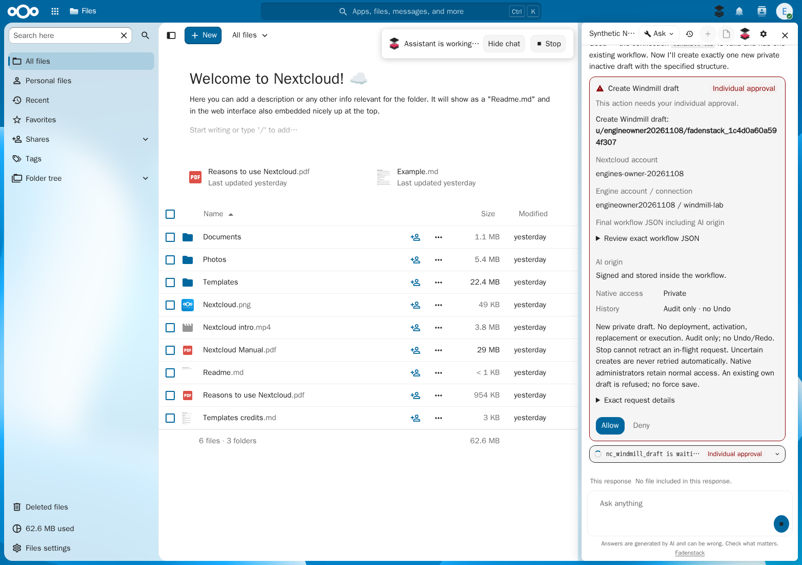
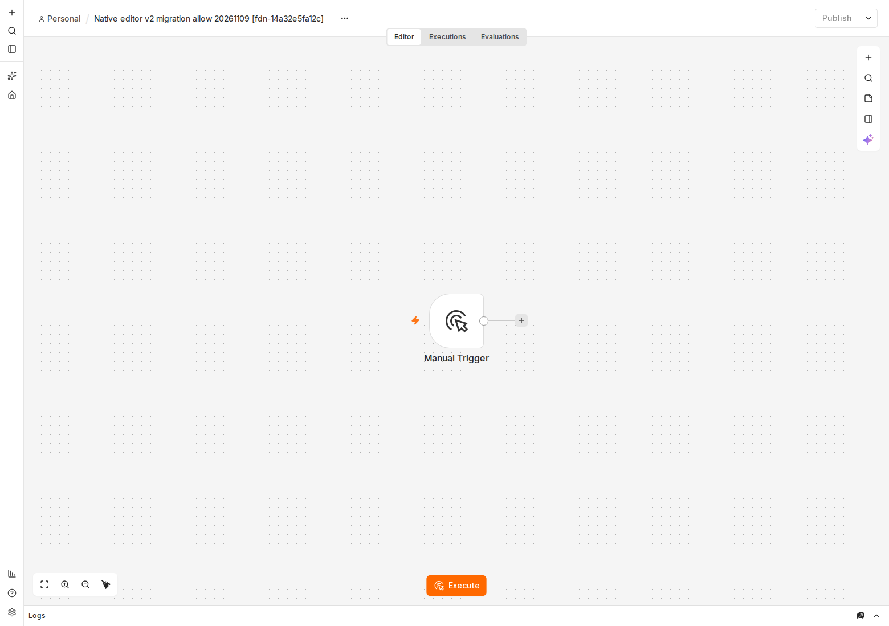
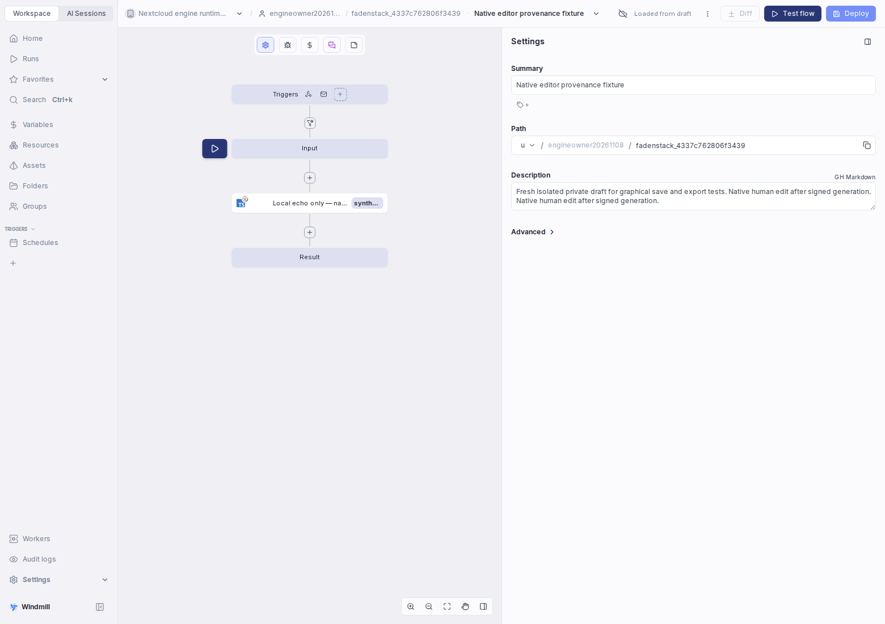
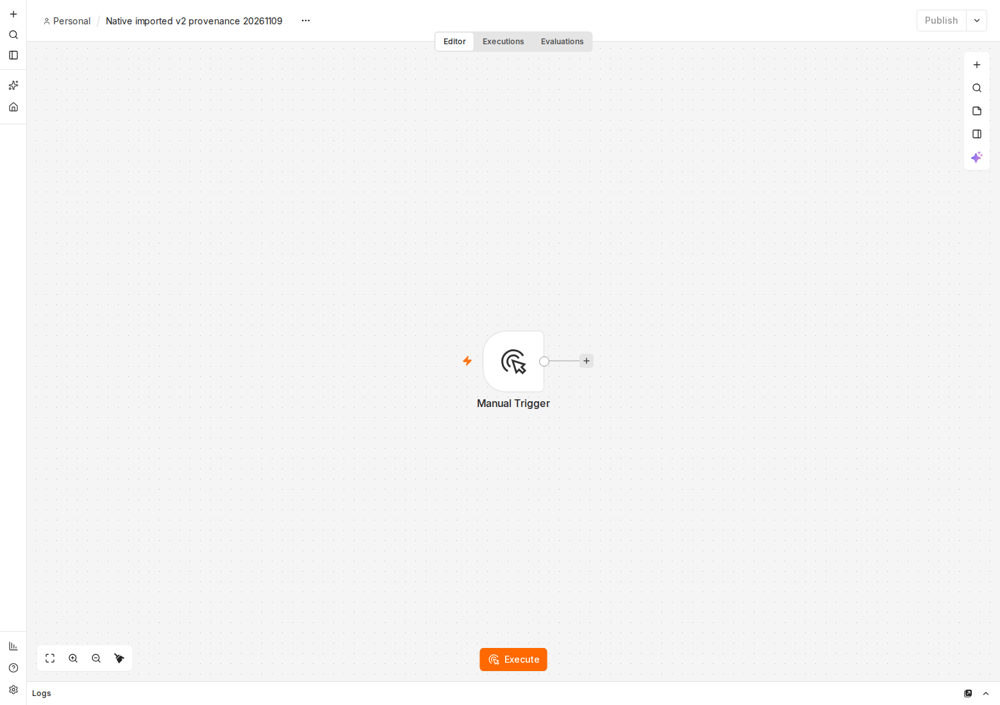

# AI origin in workflow drafts

The assistant writes origin metadata **inside the workflow before you approve
it**. Review the native account, destination and **Review exact workflow JSON**,
then choose **Allow** or **Deny**. Both engines create new private inactive
drafts. Existing workflows are not replaced or activated.

Windmill stores the marker in `schema.x-fadenstack-provenance`. New n8n drafts
store a hidden `fadenstack-provenance` comment in the first existing node's
notes. User notes and their visibility setting are preserved; no node is added.
n8n's graphical export drops the description, so older description markers
are read for compatibility but are no longer written. New n8n drafts need
at least one native node, with a maximum of 200.
The marker contains the AI-origin declaration, source profile, source digest
and signed Fadenstack record. Keep it when exporting or importing JSON.

The native extension verifies the record against the configured publisher's
signing key. After **Allow**, it reads the saved draft back and verifies that
the approved graph and marker were retained. It then sends a minimal placement
report containing the record ID, tool, media type and preserved metadata layer.
The workflow body, native account, path and engine credentials are not in that
report. Signing sends a content digest, not the workflow body.

If the placement service is unavailable, the saved workflow and its native
receipt remain valid. The assistant says the cloud placement report is
unconfirmed. **Do not create the workflow again.** Use **Agent actions →
Inspect outcome** for read-only inspection. Stop prevents further dispatch;
it cannot retract a saved draft. Drafts have audit history and no Undo/Redo.

Preserving a marker does not establish that a later edited workflow still
matches its original source. Native edits or renaming an imported n8n copy
can make the source digest stale. Native editor changes are not automatically
re-signed. A new assistant-created draft receives its own record.

On Windmill **1.841.0**, native JSON export, YAML-editor import, private draft
auto-save, reload and re-export retain the schema marker. On n8n **2.43.8**,
graphical JSON export, import into a new inactive workflow, auto-save, reload
and re-export retain the node-note marker. n8n also normalizes positions and
settings and drops the description. Retaining a signature is not proof that
the imported or edited graph still matches its signed source.

Keep the marked node's notes when copying a workflow. Removing that node or
replacing its notes can remove the marker. Model-mediated copying can also
omit previous metadata: review the final JSON. The native adapter retains
received prior markers as **unverified history**, and signs the new source;
it cannot restore metadata omitted before the proposal. Source-bound copying
and automatic re-signing of native edits remain outside this tested path.

The generic
Fadenstack detector does not extract these workflow-specific carriers from
whole vendor JSON files. Exact content checking requires the documented
canonical source bytes; a record reference alone is not an exact graph match.
This origin marker does not certify legal compliance or grant workflow access.
